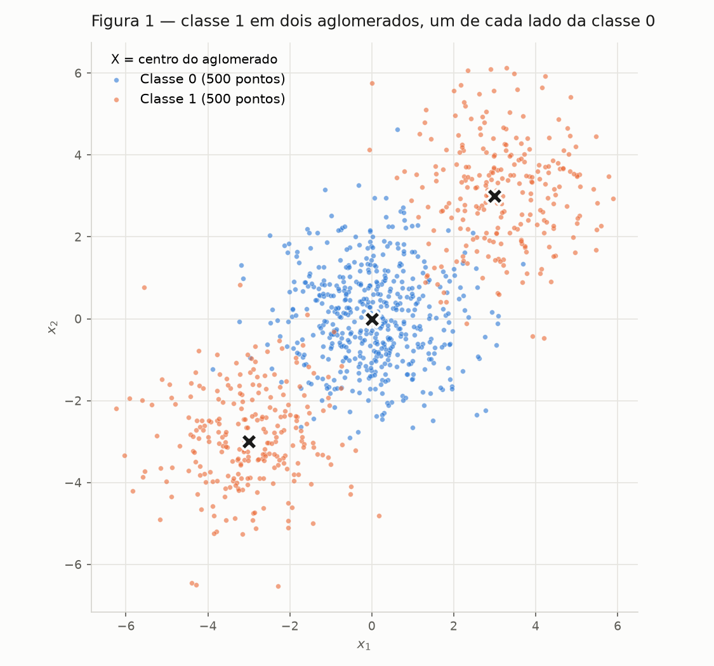
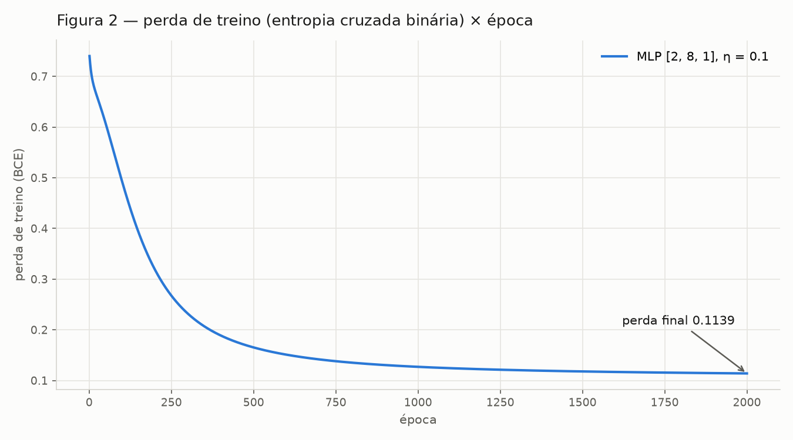
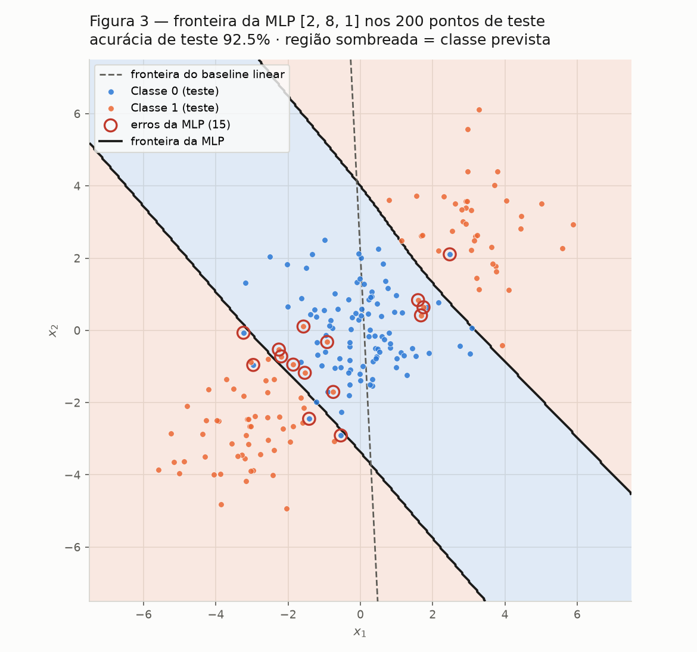
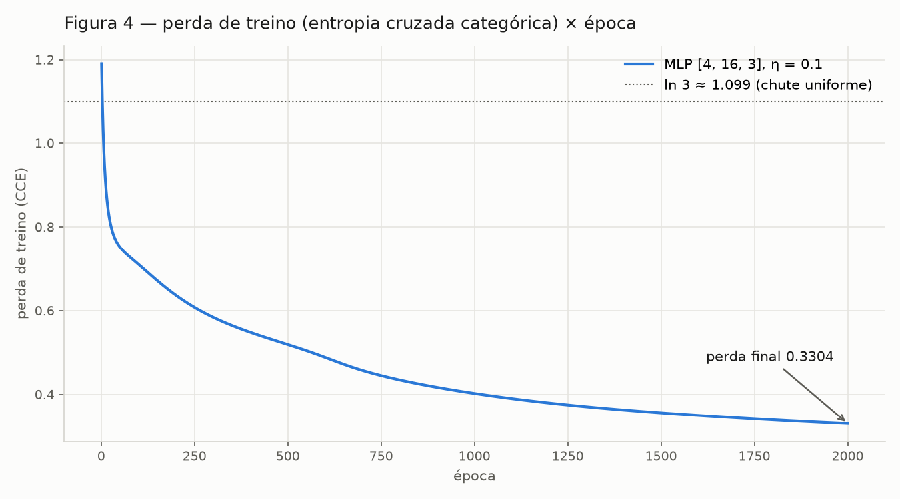
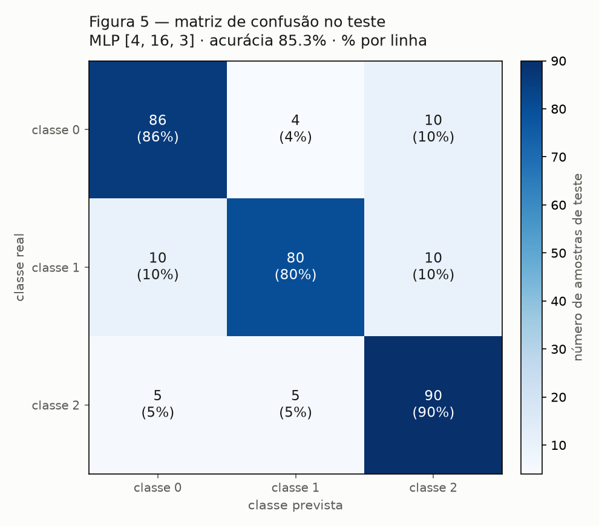
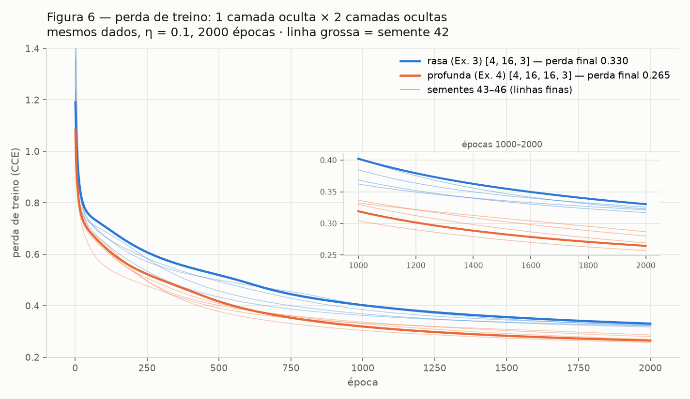

# MLP

Um perceptron multicamadas escrito do zero — forward, perda, retropropagação e
atualização — primeiro numa conta feita à mão, depois em três problemas de
classificação: um binário que nenhuma reta resolve, um de três classes e uma
comparação controlada entre uma e duas camadas ocultas.

Todo o código está em `code/` e roda com semente fixa
(`rng = np.random.default_rng(42)`); as figuras em `figures/` são exatamente as
que os scripts produzem. Só `numpy` implementa a rede: o scikit-learn entra
apenas para gerar e dividir os dados, para o baseline de regressão logística e
para a matriz de confusão.

!!! info "Como reproduzir"

    ```bash
    pip install -r requirements.txt
    cd docs/exercises/mlp/code
    python3 mlp.py               # checagem numérica dos gradientes
    python3 ex1_conferencia.py   # Ex. 1: confere a conta feita à mão
    python3 ex2_dados.py         # Ex. 2 A e B: dados, Figura 1, baseline
    python3 ex2c_treino.py       # Ex. 2 C: MLP binária, Figuras 2 e 3
    python3 ex2d_analise.py      # Ex. 2 D: melhor reta possível, forma da região
    python3 ex3_multiclasse.py   # Ex. 3 A–C: MLP de 3 classes, Figuras 4 e 5
    python3 ex3d_analise.py      # Ex. 3 D: estrutura dos aglomerados
    python3 ex4_profundidade.py  # Ex. 4: rasa × profunda, Figura 6
    ```

---

## Exercício 1

**Um passo de retropropagação, à mão.**

Rede 2 → 2 → 1 com `tanh` nas duas camadas e perda quadrática com uma única
amostra, $L = (y - \hat y)^2$. Notação da aula: $W^{(1)} \equiv W$,
$W^{(2)} \equiv V$, $b^{(1)} \equiv b^h$, $b^{(2)} \equiv b^y$.

| Grandeza | Valor |
|---|---|
| Entrada $x$ | $[0.5,\ -0.2]$ |
| Alvo $y$ | $1.0$ |
| $W^{(1)}$ | $\begin{bmatrix} 0.3 & -0.1 \\ 0.2 & 0.4 \end{bmatrix}$ |
| $b^{(1)}$ | $[0.1,\ -0.2]$ |
| $W^{(2)}$ | $[0.5,\ -0.3]$ |
| $b^{(2)}$ | $0.2$ |
| $\eta$ | $0.3$ |

Toda a conta abaixo é feita à mão, com 6 casas decimais (o enunciado pede pelo
menos 4). Para a `tanh` uso a forma $\tanh z = \dfrac{e^{2z} - 1}{e^{2z} + 1}$,
que só exige uma exponencial. O script `ex1_conferencia.py` refaz as mesmas
contas em `numpy` só para conferir: todos os valores abaixo batem com ele até a
sexta casa.

### A — Forward

**Pré-ativação da camada oculta**, $z^{(1)} = W^{(1)} x + b^{(1)}$:

$$
\begin{aligned}
z^{(1)}_1 &= 0.3 \cdot 0.5 + (-0.1)(-0.2) + 0.1 = 0.15 + 0.02 + 0.1 = \mathbf{0.270000} \\
z^{(1)}_2 &= 0.2 \cdot 0.5 + 0.4 \cdot (-0.2) - 0.2 = 0.10 - 0.08 - 0.2 = \mathbf{-0.180000}
\end{aligned}
$$

**Ativação da camada oculta**, $h^{(1)} = \tanh(z^{(1)})$:

$$
\begin{aligned}
h^{(1)}_1 &= \tanh(0.27) = \frac{e^{0.54} - 1}{e^{0.54} + 1} = \frac{0.716007}{2.716007} = \mathbf{0.263625} \\
h^{(1)}_2 &= \tanh(-0.18) = \frac{e^{-0.36} - 1}{e^{-0.36} + 1} = \frac{-0.302324}{1.697676} = \mathbf{-0.178081}
\end{aligned}
$$

**Pré-ativação da saída**, $u^{(2)} = W^{(2)} h^{(1)} + b^{(2)}$:

$$
u^{(2)} = 0.5 \cdot 0.263625 + (-0.3)(-0.178081) + 0.2
= 0.131813 + 0.053424 + 0.2 = \mathbf{0.385237}
$$

**Saída**, $\hat y = \tanh(u^{(2)})$:

$$
\hat y = \frac{e^{0.770474} - 1}{e^{0.770474} + 1} = \frac{1.160790}{3.160790} = \mathbf{0.367247}
$$

**Perda:**

$$
L = (y - \hat y)^2 = (1 - 0.367247)^2 = 0.632753^2 = \mathbf{0.400377}
$$

### B — Backward

Regra da cadeia de trás para frente. A única derivada de ativação necessária é
a da `tanh`: $\dfrac{d}{du}\tanh u = 1 - \tanh^2 u$, que se calcula **com a
saída já obtida no forward**, sem nova exponencial.

**1. Derivada da perda em relação à saída.** De $L = (y - \hat y)^2$:

$$
\frac{\partial L}{\partial \hat y} = -2\,(y - \hat y) = -2 \cdot 0.632753 = \mathbf{-1.265507}
$$

O sinal negativo diz que aumentar $\hat y$ reduz a perda — a rede está prevendo
abaixo do alvo.

**2. Através da `tanh` da saída.** Como $\hat y = \tanh(u^{(2)})$:

$$
\frac{\partial L}{\partial u^{(2)}}
= \frac{\partial L}{\partial \hat y} \cdot \left(1 - \hat y^{\,2}\right)
= -1.265507 \cdot (1 - 0.134870)
= -1.265507 \cdot 0.865130
= \mathbf{-1.094828}
$$

Chamo este valor de $\delta^{(2)}$: é o "erro" da saída, que alimenta todos os
gradientes abaixo.

**3. Gradientes da camada de saída.** Como $u^{(2)} = \sum_j W^{(2)}_j h^{(1)}_j + b^{(2)}$,
temos $\partial u^{(2)} / \partial W^{(2)}_j = h^{(1)}_j$ e
$\partial u^{(2)} / \partial b^{(2)} = 1$:

$$
\begin{aligned}
\frac{\partial L}{\partial W^{(2)}_1} &= \delta^{(2)}\, h^{(1)}_1 = -1.094828 \cdot 0.263625 = \mathbf{-0.288624} \\
\frac{\partial L}{\partial W^{(2)}_2} &= \delta^{(2)}\, h^{(1)}_2 = -1.094828 \cdot (-0.178081) = \mathbf{+0.194968} \\
\frac{\partial L}{\partial b^{(2)}} &= \delta^{(2)} \cdot 1 = \mathbf{-1.094828}
\end{aligned}
$$

**4. Propagação para a camada oculta.** Agora $\partial u^{(2)} / \partial h^{(1)}_j = W^{(2)}_j$ —
os pesos da saída são o caminho por onde o erro volta:

$$
\begin{aligned}
\frac{\partial L}{\partial h^{(1)}_1} &= \delta^{(2)}\, W^{(2)}_1 = -1.094828 \cdot 0.5 = \mathbf{-0.547414} \\
\frac{\partial L}{\partial h^{(1)}_2} &= \delta^{(2)}\, W^{(2)}_2 = -1.094828 \cdot (-0.3) = \mathbf{+0.328448}
\end{aligned}
$$

**5. Através da `tanh` oculta.** Com $h^{(1)} = \tanh(z^{(1)})$:

$$
\begin{aligned}
1 - (h^{(1)}_1)^2 &= 1 - 0.069498 = 0.930502 \\
1 - (h^{(1)}_2)^2 &= 1 - 0.031713 = 0.968287 \\[4pt]
\delta^{(1)}_1 = \frac{\partial L}{\partial z^{(1)}_1} &= -0.547414 \cdot 0.930502 = \mathbf{-0.509370} \\
\delta^{(1)}_2 = \frac{\partial L}{\partial z^{(1)}_2} &= +0.328448 \cdot 0.968287 = \mathbf{+0.318032}
\end{aligned}
$$

**6. Gradientes da camada oculta.** Como $z^{(1)}_i = \sum_k W^{(1)}_{ik} x_k + b^{(1)}_i$,
temos $\partial z^{(1)}_i / \partial W^{(1)}_{ik} = x_k$, ou seja,
$\dfrac{\partial L}{\partial W^{(1)}} = \delta^{(1)} x^\top$ (produto externo):

$$
\frac{\partial L}{\partial W^{(1)}} =
\begin{bmatrix}
-0.509370 \cdot 0.5 & -0.509370 \cdot (-0.2) \\
\phantom{-}0.318032 \cdot 0.5 & \phantom{-}0.318032 \cdot (-0.2)
\end{bmatrix}
=
\begin{bmatrix}
\mathbf{-0.254685} & \mathbf{+0.101874} \\
\mathbf{+0.159016} & \mathbf{-0.063606}
\end{bmatrix}
$$

$$
\frac{\partial L}{\partial b^{(1)}} = \delta^{(1)} = [\,\mathbf{-0.509370},\ \mathbf{+0.318032}\,]
$$

### C — Atualização dos parâmetros

Gradiente descendente, $\theta \leftarrow \theta - \eta\, \dfrac{\partial L}{\partial \theta}$
com $\eta = 0.3$:

| Parâmetro | Antes | Gradiente | $-\eta \cdot$ gradiente | **Depois** |
|---|---|---|---|---|
| $W^{(2)}_1$ | 0.5 | −0.288624 | +0.086587 | **0.586587** |
| $W^{(2)}_2$ | −0.3 | +0.194968 | −0.058490 | **−0.358490** |
| $b^{(2)}$ | 0.2 | −1.094828 | +0.328448 | **0.528448** |
| $W^{(1)}_{11}$ | 0.3 | −0.254685 | +0.076405 | **0.376405** |
| $W^{(1)}_{12}$ | −0.1 | +0.101874 | −0.030562 | **−0.130562** |
| $W^{(1)}_{21}$ | 0.2 | +0.159016 | −0.047705 | **0.152295** |
| $W^{(1)}_{22}$ | 0.4 | −0.063606 | +0.019082 | **0.419082** |
| $b^{(1)}_1$ | 0.1 | −0.509370 | +0.152811 | **0.252811** |
| $b^{(1)}_2$ | −0.2 | +0.318032 | −0.095410 | **−0.295410** |

!!! note "São nove parâmetros, não oito"

    O enunciado fala em "os oito parâmetros", mas a rede descrita tem
    $4 + 2 + 2 + 1 = 9$: quatro pesos em $W^{(1)}$, dois vieses em $b^{(1)}$,
    dois pesos em $W^{(2)}$ e o viés $b^{(2)}$. A tabela atualiza todos os nove.

**A perda sobe ou desce num segundo forward?** **Desce.** Todo parâmetro andou
no sentido contrário ao do seu gradiente, e para um passo pequeno a expansão de
Taylor de primeira ordem dá

$$
\Delta L \approx \nabla L \cdot \Delta\theta = \nabla L \cdot (-\eta\,\nabla L) = -\eta\,\lVert \nabla L \rVert^2 \le 0 .
$$

Aqui $\lVert \nabla L \rVert^2 = 1.7851$, então a previsão de primeira ordem é
$\Delta L \approx -0.3 \cdot 1.7851 = -0.5355$. A leitura intuitiva é a mesma:
$\delta^{(2)} < 0$ significava "aumente $u^{(2)}$", e todos os parâmetros que
aumentam $u^{(2)}$ aumentaram — $b^{(2)}$ subiu, o peso de $h^{(1)}_1 > 0$
subiu, o peso de $h^{(1)}_2 < 0$ ficou mais negativo.

Conferindo com um segundo forward (no script): $\hat y$ vai de 0.367247 para
**0.711181** e a perda cai de 0.400377 para **0.083417** ($\Delta L = -0.316960$).
A queda real é menor que a prevista ($-0.317$ contra $-0.536$) porque
$\eta = 0.3$ não é um passo pequeno: a aproximação linear superestima o ganho,
e a curvatura da `tanh` (que satura perto de 1) devolve parte dele. Com um
$\eta$ grande demais a perda poderia até subir; com este, desce.

### Código do Exercício 1

??? example "code/ex1_conferencia.py — conferência numérica da conta à mão"

    ```python
    --8<-- "docs/exercises/mlp/code/ex1_conferencia.py"
    ```

---

## Exercício 2

**Classificação binária que uma reta não resolve.**

### A — Dados

`make_blobs` com três aglomerados de desvio 1.2. O central forma a classe 0 e os
dois externos, em lados opostos, formam a classe 1:

| Aglomerado | Centro | Amostras | Classe |
|---|---|---|---|
| central | (0, 0) | 500 | 0 |
| superior | (3, 3) | 250 | 1 |
| inferior | (−3, −3) | 250 | 1 |

Divisão 80/20 com `train_test_split(test_size=0.2, random_state=42, stratify=y)`:
800 de treino (400 por classe) e 200 de teste (100 por classe).



**Figura 1** — os 1000 pontos coloridos pela classe; **×** marca o centro de cada
aglomerado. A classe 1 aparece dos dois lados da classe 0, ao longo da diagonal.

### B — Baseline linear

Regressão logística (uma única fronteira linear) treinada nas 800 amostras de
treino:

```
w = [0.0296 0.0015] | b = -0.0031
acurácia de treino: 0.5275
acurácia de teste : 0.4750
```

**Acurácia de teste do baseline: 47.50%** — abaixo do acaso, como o enunciado
antecipa. O item D explica de onde vem esse número.

### C — MLP do zero

A implementação está em `code/mlp.py`, num módulo próprio porque os Exercícios 3
e 4 a reutilizam sem alteração. Os tamanhos das camadas são o argumento
`camadas` do construtor: `MLP([2, 8, 1], ...)` é uma rede de 2 entradas, uma
oculta de 8 e uma saída.

| Componente | Implementação |
|---|---|
| Arquitetura | **[2, 8, 1]** — 2 entradas, 1 camada oculta de 8, 1 saída (33 parâmetros) |
| Ativações | `tanh` na oculta, sigmoide na saída |
| Perda | entropia cruzada binária, $L = -\frac{1}{N}\sum \left[y \log p + (1-y)\log(1-p)\right]$ |
| Inicialização | Xavier/Glorot, $W \sim \mathcal N\!\left(0,\ \frac{2}{n_\text{in} + n_\text{out}}\right)$, $b = 0$, com `rng = default_rng(42)` |
| Otimização | gradiente descendente em lote completo, **η = 0.1**, **2000 épocas** |

**Forward**, camada a camada, com uma amostra por linha de $X$:

$$
A^{(0)} = X, \qquad Z^{(l)} = A^{(l-1)} W^{(l)\top} + b^{(l)}, \qquad
A^{(l)} = \tanh\!\left(Z^{(l)}\right), \qquad P = \sigma\!\left(Z^{(L)}\right)
$$

**Backward.** O gradiente da perda na pré-ativação da saída é
$\dfrac{\partial L}{\partial Z^{(L)}} = \dfrac{1}{N}(P - Y)$ (a derivação está no
Exercício 3 B, porque vale igual para sigmoide + BCE e softmax + entropia
cruzada). A partir dele, para cada camada, de trás para frente:

$$
\frac{\partial L}{\partial W^{(l)}} = \delta^{(l)\top} A^{(l-1)}, \qquad
\frac{\partial L}{\partial b^{(l)}} = \sum_{n} \delta^{(l)}_n, \qquad
\delta^{(l-1)} = \left(\delta^{(l)} W^{(l)}\right) \odot \left(1 - \left(A^{(l-1)}\right)^2\right)
$$

São exatamente os passos 3 a 6 do Exercício 1, escritos em forma matricial para
N amostras e qualquer número de camadas. A retropropagação foi conferida contra
diferenças finitas centrais em todas as configurações usadas no relatório:

```
checagem de gradientes (maior erro relativo, backward x diferencas finitas)
  binaria, 1 oculta      [4, 5, 1]      3.31e-07
  binaria, 2 ocultas     [4, 5, 3, 1]   1.58e-08
  3 classes, 1 oculta    [4, 5, 3]      7.19e-08
  3 classes, 2 ocultas   [4, 5, 4, 3]   2.17e-08
```

**Atualização:** $W^{(l)} \leftarrow W^{(l)} - \eta\, \partial L / \partial W^{(l)}$,
e o mesmo para $b^{(l)}$.

#### Resultado

```
arquitetura      : [2, 8, 1] (tanh na oculta, sigmoide na saida)
eta, epocas      : 0.1, 2000 (lote completo)
perda inicial    : 0.7401
perda final      : 0.1139
acuracia treino  : 0.9637
acuracia teste   : 0.9250
```

**Acurácia de teste da MLP: 92.50%** (15 erros em 200), contra 47.50% do
baseline linear.



**Figura 2** — perda de treino por época. Há um platô curto no começo (a perda
fica perto de $\ln 2 \approx 0.693$ enquanto os neurônios ocultos ainda não se
especializaram), uma queda rápida entre as épocas 50 e 400 e depois uma descida
lenta até 0.1139.



**Figura 3** — a rede avaliada numa grade de 400 × 400 pontos, com a região de
cada classe sombreada, sobre os 200 pontos de teste. A linha cheia é a fronteira
da MLP ($p = 0.5$); a tracejada, a fronteira do baseline linear. Os 15 erros
(círculos vermelhos) ficam todos na zona de sobreposição entre o aglomerado
central e os externos.

### D — Análise

#### Por que o baseline fica abaixo de 50%

O ponto de partida é a geometria da Figura 1: os dois aglomerados da classe 1
são **simétricos em relação ao centro da classe 0**. A média da classe 1 cai,
portanto, praticamente em cima da média da classe 0 — no treino, (0.21, 0.21)
contra (0.02, 0.06). Um modelo linear só tem uma direção para olhar, e nessa
geometria nenhuma direção distingue as classes *em média*.

A regressão logística não maximiza acurácia: ela minimiza a log-loss. Inclinar
a reta na direção da diagonal acertaria com confiança o aglomerado (3, 3), mas
erraria com a mesma confiança o aglomerado (−3, −3), e a log-loss pune um erro
confiante mais do que recompensa um acerto confiante. O ótimo que ela encontra é
então quase não tomar partido: $w \approx [0.030, 0.0015]$, com as probabilidades
previstas no teste presas entre **0.457 e 0.544**. A fronteira resultante é uma
reta quase vertical que passa pelo centro, em $x_1 \approx 0.1$ (tracejada na
Figura 3), e o resultado aglomerado a aglomerado, no teste, é:

| Aglomerado | Classe | Pontos no teste | Acerto do baseline |
|---|---|---|---|
| central (0, 0) | 0 | 100 | 53.0% — a reta o corta ao meio |
| superior (3, 3) | 1 | 42 | 100% — inteiro do lado "classe 1" |
| inferior (−3, −3) | 1 | 58 | 0% — inteiro do lado "classe 0" |
| **total** | | **200** | **(53 + 42 + 0) / 200 = 47.5%** |

O valor esperado dessa fronteira é 50% (metade do centro, um aglomerado externo
inteiro, nada do outro). O teste fica **abaixo** de 50% por acaso de amostragem:
ele tem 58 pontos do aglomerado perdido e só 42 do aglomerado ganho.

Isso não significa que nenhuma reta passe de 50%. Uma busca exaustiva (720
direções × todos os cortes) acha uma reta com **75.5%** no teste, isolando um
dos aglomerados externos. Mas 75% é o teto de **qualquer** reta, como mostra o
próximo argumento.

#### Por que nenhuma reta produz a região da Figura 3

A região que a MLP atribui à classe 1 são **dois semiplanos disjuntos**, um de
cada lado de uma faixa diagonal que contém a classe 0. Percorrendo a diagonal
$x_1 = x_2$ de −7 a 7, a classe prevista vai de 1 para 0 em $t = -2.25$ e volta
para 1 em $t = +2.39$; ao longo da antidiagonal, é classe 0 o tempo todo. A
região da classe 1 é **desconexa e não-convexa**.

Uma reta só produz um semiplano, e todo semiplano é **convexo**: se dois pontos
estão nele, o segmento entre eles também está. Os centros (3, 3) e (−3, −3)
precisariam estar no semiplano da classe 1, e o ponto médio entre eles, (0, 0),
cairia junto — mas (0, 0) é o centro da classe 0. Por isso uma reta consegue no
máximo um dos dois aglomerados externos (o teto de ~75%), e a reta que a
regressão logística escolhe não fica nem com isso.

A MLP escapa dessa limitação porque cada neurônio oculto é um semiplano "suave"
($\tanh(w \cdot x + b)$), e a camada de saída **combina** esses semiplanos. Dois
neurônios com normais opostas ao longo da diagonal bastam para formar
"$|x_1 + x_2|$ grande", que é exatamente a faixa da Figura 3 — as duas bordas
quase paralelas da fronteira são essas duas retas. O que a camada oculta compra
é a possibilidade de uma região que é a **união** de semiplanos, e não um só.

### Código do Exercício 2

??? example "code/mlp.py — a MLP: forward, backward, atualização (reutilizada nos Exercícios 3 e 4)"

    ```python
    --8<-- "docs/exercises/mlp/code/mlp.py"
    ```

??? example "code/ex2_dados.py — dados, Figura 1 e baseline linear"

    ```python
    --8<-- "docs/exercises/mlp/code/ex2_dados.py"
    ```

??? example "code/ex2c_treino.py — treino da MLP, Figuras 2 e 3"

    ```python
    --8<-- "docs/exercises/mlp/code/ex2c_treino.py"
    ```

??? example "code/ex2d_analise.py — melhor reta possível e forma da região da MLP"

    ```python
    --8<-- "docs/exercises/mlp/code/ex2d_analise.py"
    ```

??? example "code/_saida.py — caminhos de figures/ e estilo das figuras"

    ```python
    --8<-- "docs/exercises/mlp/code/_saida.py"
    ```

---

## Exercício 3

**Multiclasse, a mesma rede.**

### A — Dados

`make_classification` com `n_samples=1500`, `n_features=4`, `n_informative=4`,
`n_redundant=0`, `n_repeated=0`, `n_classes=3`, `n_clusters_per_class=2`,
`class_sep=1.0`, `random_state=42` — seis aglomerados, dois por classe, nos
vértices de um hipercubo em 4D. Por classe: 499 / 499 / 502 (o `flip_y=0.01`
padrão sorteia de novo o rótulo de 1% dos pontos, o que desequilibra
ligeiramente as classes).

Divisão 80/20 estratificada com a mesma semente: 1200 de treino
(399 / 399 / 402) e 300 de teste (100 por classe).

### B — Adaptação para três classes

A saída passa a ter **3 unidades**, com **softmax** para produzir
probabilidades e **entropia cruzada categórica** como perda:

$$
p_k = \frac{e^{u_k}}{\sum_{j=1}^{K} e^{u_j}}, \qquad
L = -\sum_{k=1}^{K} y_k \log p_k \quad (y \text{ one-hot})
$$

#### Derivação de $\partial L / \partial u$

**Derivada do softmax.** Para $p_k = e^{u_k} / S$ com $S = \sum_j e^{u_j}$,
pela regra do quociente:

$$
\frac{\partial p_k}{\partial u_j}
= \frac{\delta_{kj}\, e^{u_k} S - e^{u_k} e^{u_j}}{S^2}
= p_k\,(\delta_{kj} - p_j),
$$

onde $\delta_{kj} = 1$ se $k = j$ e 0 caso contrário. Toda saída depende de
toda pré-ativação, por isso a derivada é uma matriz (jacobiana), e não um vetor
como na `tanh`.

**Regra da cadeia através da perda.** Como $\partial L / \partial p_k = -y_k / p_k$:

$$
\frac{\partial L}{\partial u_j}
= \sum_k \frac{\partial L}{\partial p_k}\,\frac{\partial p_k}{\partial u_j}
= \sum_k \left(-\frac{y_k}{p_k}\right) p_k\,(\delta_{kj} - p_j)
= -\sum_k y_k\,\delta_{kj} + p_j \sum_k y_k
= -y_j + p_j \cdot 1
$$

usando $\sum_k y_k = 1$ (one-hot). Portanto

$$
\boxed{\ \frac{\partial L}{\partial u} = p - y\ }
$$

e, com a perda média sobre $N$ amostras, $\dfrac{\partial L}{\partial U} = \dfrac{1}{N}(P - Y)$.
O $p_k$ do denominador da log cancela com o $p_k$ do numerador do softmax: a
jacobiana inteira colapsa numa subtração.

**O mesmo vale para sigmoide + BCE.** Com $p = \sigma(u)$, $\sigma'(u) = p(1-p)$ e
$\partial L / \partial p = -\frac{y}{p} + \frac{1-y}{1-p} = \frac{p - y}{p(1-p)}$,
o produto também dá $\partial L / \partial u = p - y$. É esse fato que permite
usar **o mesmo backward** nos dois exercícios: a perda só precisa fornecer o
delta inicial $(P - Y)/N$; da saída para trás, a conta é idêntica.

#### Reutilização literal do código do Exercício 2

`mlp.py` **não foi alterado** entre os Exercícios 2 e 3: os métodos `forward`,
`backward`, `atualizar` e `treinar` são os mesmos, executados sem mudar uma
linha. A saída e a perda são um objeto passado à rede, e a diferença entre os
dois exercícios cabe em uma linha cada:

```python
# Exercício 2 — saída binária
MLP([2, 8, 1],  SigmoideBCE(), rng).treinar(X_tr, y_tr, eta=0.1, epocas=2000)

# Exercício 3 — saída de 3 classes
MLP([4, 16, 3], SoftmaxCCE(),  rng).treinar(X_tr, y_tr, eta=0.1, epocas=2000)
```

Mudam o tamanho da saída (o último número de `camadas`), a perda (`SoftmaxCCE`
no lugar de `SigmoideBCE`) e os hiperparâmetros — exatamente o que o enunciado
permite. As duas classes de saída implementam a mesma interface (`ativar`,
`perda`, `delta`, `alvo`, `classificar`), e o `delta` das duas é o mesmo
$(P - Y)/N$ derivado acima.

### C — Treino e avaliação

| Componente | Valor |
|---|---|
| Arquitetura | **[4, 16, 3]** — 4 entradas, 1 camada oculta de 16 (`tanh`), 3 saídas (softmax) |
| Parâmetros | 131 |
| Otimização | gradiente descendente em lote completo, **η = 0.1**, **2000 épocas** |
| Inicialização | Xavier, `rng = default_rng(42)` |

```
perda inicial   : 1.1904
perda final     : 0.3304
acuracia treino : 0.8733
acuracia teste  : 0.8533
```

**Acurácia de teste: 85.33%** (44 erros em 300).



**Figura 4** — perda de treino por época. Ela parte de 1.19, um pouco acima de
$\ln 3 \approx 1.099$ (o valor de um chute uniforme entre três classes), cai
rápido nas primeiras ~50 épocas e segue descendo devagar até 0.3304, ainda sem
platô aos 2000.



**Figura 5** — matriz de confusão no teste (linhas = classe real, colunas =
prevista, com a porcentagem da linha). A classe 1 é a de menor acerto (80%), e
seus erros se dividem igualmente entre as outras duas (10 e 10).

### D — Análise

#### O par mais confundido

Somando os dois sentidos de cada par na Figura 5:

| Par | Confusões | Detalhe |
|---|---|---|
| 0 – 2 | **15** | 10 de 0 → 2, 5 de 2 → 0 |
| 1 – 2 | **15** | 10 de 1 → 2, 5 de 2 → 1 |
| 0 – 1 | **14** | 4 de 0 → 1, 10 de 1 → 0 |

Nesta semente **não há um par dominante**: os três estão dentro de 1 erro um do
outro, e qualquer escolha seria ruído. Para responder com honestidade, treinei a
mesma rede com 5 sementes de inicialização (42 a 46) e somei as confusões:

| Par | Soma em 5 sementes |
|---|---|
| **0 – 1** | **90** |
| 1 – 2 | 74 |
| 0 – 2 | 71 |

O par **0 – 1** é o mais confundido de forma estável. E há um padrão ainda mais
estável que o par: **a classe 1 tem o menor acerto nas cinco sementes**
(76%–80%, contra 84%–87% da classe 0 e 88%–90% da classe 2). A classe 1 é o
centro da confusão — e a razão está na estrutura dos aglomerados.

#### A explicação pela estrutura dos aglomerados

`make_classification` não informa de que aglomerado veio cada ponto, mas isso é
recuperável: gerando de novo com `shuffle=False` e a mesma semente, os pontos
saem em blocos de 250, um por aglomerado (o aglomerado $k$ é da classe
$k \bmod 3$). Com isso, os seis aglomerados ficam nestes vértices do hipercubo
($\pm 1$ em cada uma das 4 coordenadas):

| Aglomerado | Classe | Vértice |
|---|---|---|
| A0 | 0 | − − − − |
| A3 | 0 | + − + + |
| A1 | 1 | − + − − |
| A4 | 1 | − + + + |
| A2 | 2 | − + − + |
| A5 | 2 | + + + − |

Em 4 dimensões há 16 vértices; com 6 aglomerados, alguns ficam **adjacentes**
(diferem em uma única coordenada). Mas a distância entre centros sozinha engana,
porque `make_classification` estica cada aglomerado com uma transformação linear
aleatória. A medida certa é a distância entre centros dividida pela soma dos
desvios **na direção que liga os dois centros** — quanto menor, mais os
aglomerados se sobrepõem:

| Par de aglomerados | Classes | Coord. diferentes | Distância | Separação |
|---|---|---|---|---|
| A1 – A2 | **1 – 2** | 1 | 2.08 | **0.84** |
| A2 – A4 | **1 – 2** | 1 | 1.92 | **0.94** |
| A0 – A1 | **0 – 1** | 1 | 2.03 | **0.98** |
| A3 – A5 | 0 – 2 | 2 | 3.03 | 1.13 |
| A1 – A5 | 1 – 2 | 2 | 2.67 | 1.22 |
| demais 7 pares | | 2–4 | 2.94–3.95 | 1.35–2.79 |

Os três pares mais sobrepostos **envolvem todos a classe 1**, e o aglomerado A1
aparece em dois deles: ele é vizinho direto de A0 (classe 0) **e** de A2
(classe 2). A1 está numa encruzilhada de três classes — e os erros da MLP no
teste confirmam isso:

| Aglomerado | Pontos no teste | Erros | Para onde vão |
|---|---|---|---|
| **A1 (classe 1)** | 49 | **17** | 9 → classe 0, 8 → classe 2 |
| A3 (classe 0) | 49 | 9 | 7 → classe 2, 2 → classe 1 |
| A2 (classe 2) | 46 | 8 | 5 → classe 1, 1 → classe 0, mais 2 rótulos invertidos |
| A0 (classe 0) | 51 | 5 | 3 → classe 2, 2 → classe 1 |
| A5 (classe 2) | 56 | 4 | 4 → classe 0 |
| A4 (classe 1) | 49 | 1 | 1 → classe 0 |

Sozinho, A1 responde por **17 dos 44 erros**, divididos quase igualmente entre
as duas classes vizinhas — é por isso que a linha da classe 1 na Figura 5 é
10 / 80 / 10. O 0 – 2, que nesta semente empata, vem principalmente de **A3**:
seu centro está longe de A5 (3.03), mas A3 é o aglomerado mais esticado do
dataset (desvio 1.57 na direção de A5), e a cauda dele invade a região da
classe 2.

Existe ainda um piso de erro que nenhum modelo remove: o `flip_y` sorteou de
novo 11 rótulos dos 1500, dois deles no teste.

#### Baseline e o que a camada oculta acrescentou

| Modelo | Acurácia de teste |
|---|---|
| Regressão logística multinomial | **66.33%** |
| MLP [4, 16, 3] | **85.33%** |

A regressão logística dá a cada classe **uma** região convexa (a interseção de
semiplanos). Mas cada classe aqui são **dois aglomerados em vértices opostos o
suficiente** para que a região convexa que contém os dois engula aglomerados de
outras classes. A0 (− − − −) e A3 (+ − + +), da classe 0, diferem em três
coordenadas, e o caminho entre eles passa pelo território de outras classes. A
matriz de confusão do baseline mostra o estrago concentrado em 1 – 2 (32 + 25 =
57 confusões, contra 15 da MLP).

A camada oculta dá à rede **16 semiplanos** para combinar. Com eles, cada classe
pode ocupar uma região formada por **dois pedaços separados**, um em volta de
cada aglomerado — a mesma operação que no Exercício 2 permitiu à classe 1 ficar
com os dois lados da diagonal. É a capacidade de fazer **uniões** de regiões
convexas que leva a acurácia de 66% a 85%.

### Código do Exercício 3

??? example "code/ex3_multiclasse.py — dados, treino, Figuras 4 e 5, baseline"

    ```python
    --8<-- "docs/exercises/mlp/code/ex3_multiclasse.py"
    ```

??? example "code/ex3d_analise.py — aglomerados, separação e erros por aglomerado"

    ```python
    --8<-- "docs/exercises/mlp/code/ex3d_analise.py"
    ```

---

## Exercício 4

**Uma segunda camada oculta ajuda?**

### A — Rede mais profunda

Mesmos dados, mesma divisão, mesmo **η = 0.1** e mesmas **2000 épocas** do
Exercício 3. A única mudança é a profundidade:

| | Exercício 3 (rasa) | Exercício 4 (profunda) |
|---|---|---|
| Arquitetura | [4, 16, 3] | **[4, 16, 16, 3]** |
| Camadas ocultas | 1 | **2** (16 + 16, ambas `tanh`) |

O código é o mesmo `mlp.py`, só com `camadas=[4, 16, 16, 3]`.

**Acurácia de teste da rede profunda (semente 42): 85.33%** — idêntica à da rasa
nesta semente. A média em 5 sementes está no item B.

### B — Comparação controlada

As duas redes foram treinadas com **5 sementes de inicialização** (42 a 46). A
semente só muda os pesos iniciais; os dados e a divisão são sempre os mesmos.

Há um problema na comparação pedida: a rede profunda tem **403 parâmetros**, três
vezes os 131 da rasa. Se ela vencer, não dá para saber se foi a profundidade ou
o tamanho. Por isso acrescentei um **controle**: a rede **[4, 48, 3]**, rasa
como a do Exercício 3, mas com 387 parâmetros, quase o mesmo número da profunda.
Ela muda o tamanho sem mudar a profundidade.



**Figura 6** — perda de treino da rede rasa (azul) e da profunda (laranja) no
mesmo eixo. Linha grossa = semente 42; linhas finas = sementes 43 a 46. O
detalhe mostra as épocas 1000–2000. A profunda fica abaixo da rasa em
praticamente todo o treino, e a diferença se mantém nas cinco sementes.

| | Ex. 3 — rasa | Ex. 4 — profunda | Controle — rasa e larga |
|---|---|---|---|
| Arquitetura | [4, 16, 3] | [4, 16, 16, 3] | [4, 48, 3] |
| Camadas ocultas | **1** | **2** | 1 |
| Parâmetros | **131** | **403** | 387 |
| Perda final de treino (média) | **0.3235** ± 0.0049 | **0.2715** ± 0.0120 | 0.3015 ± 0.0048 |
| Acurácia de treino (média) | 88.02% | 90.13% | 89.02% |
| **Acurácia de teste (média)** | **84.33%** ± 0.62 | **85.47%** ± 0.96 | **86.00%** ± 0.71 |
| Acurácia de teste (semente 42) | 85.33% | 85.33% | 86.00% |

Médias sobre as 5 sementes; ± é o desvio-padrão entre elas.

Acurácia de teste semente a semente:

| Semente | Rasa | Profunda | Diferença |
|---|---|---|---|
| 42 | 85.33% | 85.33% | 0.00 |
| 43 | 84.33% | 87.00% | +2.67 |
| 44 | 84.00% | 85.33% | +1.33 |
| 45 | 84.33% | 84.33% | 0.00 |
| 46 | 83.67% | 85.33% | +1.67 |
| **média** | **84.33%** | **85.47%** | **+1.13** |

### C — Análise

#### O resultado, sem ajuste

O enunciado antecipa que a rede profunda provavelmente não vence a rasa. **Aqui
ela vence por pouco: +1.13 ponto percentual** na média de 5 sementes, e nunca
perde semente a semente. Não ajustei nada para chegar nesse número — é a
primeira configuração testada, com o η e as épocas fixados no Exercício 3.

Mas esse ganho precisa ser lido com cuidado, por dois motivos.

**É pequeno diante do ruído do teste.** Com 300 pontos, um único ponto vale 0.33
p.p., e o erro-padrão amostral de uma acurácia de ~84% é **2.1 p.p.** O ganho
médio de 1.13 p.p. equivale a 3–4 pontos de teste, metade do erro-padrão. É
consistente entre sementes, mas não é uma diferença que mudaria uma conclusão.

**E não é da profundidade.** É isso que o controle mostra. A rede rasa e larga,
com o mesmo orçamento de parâmetros da profunda, chega a **86.00%**, acima da
profunda (85.47%). Comparando as duas redes de tamanho igual, a segunda camada
**perde 0.53 p.p.** no teste. O ganho sobre o Exercício 3 vem de ter mais
parâmetros, e não de empilhá-los.

#### Perda de treino e acurácia de teste contam histórias diferentes

| | Rasa | Profunda | Larga |
|---|---|---|---|
| Perda de treino | 0.3235 | **0.2715** (a melhor) | 0.3015 |
| Acurácia de teste | 84.33% | 85.47% | **86.00%** (a melhor) |
| Treino − teste | 3.7 p.p. | **4.7 p.p.** | 3.0 p.p. |

Pela perda de treino, a profunda é claramente a melhor: 16% abaixo da rasa e 10%
abaixo da larga. Pelo teste, ela fica atrás da larga. E a distância entre
treino e teste é a maior das três. A capacidade extra que a segunda camada dá
está sendo usada para ajustar o **conjunto de treino**, e não para generalizar.
Neste dataset, "ajustar melhor o treino" significa desenhar fronteiras mais
contorcidas nas zonas onde aglomerados de classes diferentes se sobrepõem (as
separações de 0.84 a 0.98 do Exercício 3 D) e em volta dos 11 rótulos
invertidos. Nessas regiões não há fronteira certa para aprender, só ruído.

#### Por que a profundidade não ajuda neste problema

**O que a fronteira precisa.** São 6 aglomerados aproximadamente gaussianos em
4D. A fronteira ótima entre dois aglomerados vizinhos é aproximadamente uma
superfície suave e quase plana. A fronteira de cada classe é então a borda de
uma **união de duas regiões aproximadamente convexas**. Uma camada oculta de 16
`tanh` já dá 16 hiperplanos — mais do que o necessário para cercar 6 aglomerados.
O problema não tem uma fronteira complexa a mais para aprender. O que limita a
acurácia é a sobreposição real entre aglomerados, e nenhuma arquitetura passa
desse teto.

**O que uma segunda camada acrescenta, em representação.** Composição. A
primeira camada corta o espaço em semiplanos. A segunda combina esses
semiplanos em regiões, e a saída combina regiões. Isso compensa quando a
fronteira tem **estrutura repetida ou hierárquica** — quando as mesmas
"peças" aparecem combinadas de muitas formas. Seis aglomerados não têm essa
estrutura: cada um é uma peça só, e uma camada já basta para montá-las.

**O que ela custa, em otimização.** O gradiente da primeira camada passa a ser
o produto de mais termos $(1 - \tanh^2)$, todos menores que 1. A superfície de
perda fica mais não-convexa, e o resultado passa a depender mais da
inicialização. Com só duas camadas e inicialização Xavier, o custo mais grave
(gradientes que desaparecem) não apareceu — a Figura 6 mostra a profunda
descendo mais rápido desde o começo. O custo que apareceu foi a
**instabilidade**: o desvio entre sementes dobra, tanto na perda de treino
(0.0120 contra 0.0049) quanto na acurácia de teste (0.96 contra 0.62 p.p.).

#### Que dados recompensariam a profundidade

Dados cuja fronteira seja **composicional** — muitas regiões construídas a partir
de poucas peças reaproveitadas:

- **Paridade / tabuleiro de xadrez em várias dimensões.** A classe depende do
  XOR de várias coordenadas. Uma rede rasa precisa de um número de neurônios que
  cresce exponencialmente com a dimensão; uma rede profunda resolve com um
  número que cresce linearmente, compondo XORs de XORs.
- **Espirais entrelaçadas**, em que cada volta reaproveita a forma da anterior.
- **Imagens, áudio e texto**, em que a estrutura é hierárquica por natureza
  (bordas → partes → objetos) e cada camada aprende um nível.

Seis aglomerados gaussianos com sobreposição não são nenhum desses casos. Aqui,
o que compra acurácia é largura. A profundidade compra perda de treino.

### Código do Exercício 4

??? example "code/ex4_profundidade.py — rasa × profunda × controle, 5 sementes, Figura 6"

    ```python
    --8<-- "docs/exercises/mlp/code/ex4_profundidade.py"
    ```

---

## Resumo dos resultados

| # | Quantidade | Valor |
|---|---|---|
| 1 | Ex. 1 — $z^{(1)}$ e $h^{(1)}$ | $z^{(1)}$ = **[0.270000, −0.180000]** · $h^{(1)}$ = **[0.263625, −0.178081]** |
| 2 | Ex. 1 — $u^{(2)}$, $\hat y$ e $L$ | $u^{(2)}$ = **0.385237** · $\hat y$ = **0.367247** · $L$ = **0.400377** |
| 3 | Ex. 1 — parâmetros atualizados | $W^{(1)}$ = **[[0.376405, −0.130562], [0.152295, 0.419082]]** · $b^{(1)}$ = **[0.252811, −0.295410]** · $W^{(2)}$ = **[0.586587, −0.358490]** · $b^{(2)}$ = **0.528448** |
| 4 | Ex. 2 — acurácia de teste do baseline linear | **47.50%** |
| 5 | Ex. 2 — arquitetura e acurácia de teste | **[2, 8, 1]** (tanh / sigmoide, η = 0.1, 2000 épocas) · **92.50%** |
| 6 | Ex. 3 — arquitetura e acurácia de teste | **[4, 16, 3]** (tanh / softmax, η = 0.1, 2000 épocas) · **85.33%** |
| 7 | Ex. 3 — par mais confundido | **0 – 1** (90 confusões em 5 sementes); na Figura 5, empate técnico 15 / 15 / 14 |
| 8 | Ex. 4 — arquitetura e acurácia de teste | **[4, 16, 16, 3]** · **85.33%** (semente 42) · **85.47%** (média de 5 sementes) |
| 9 | Ex. 4 — diferença de acurácia vs. Ex. 3 (média de 5 sementes) | **+1.13 p.p.** (85.47% contra 84.33%) |

Notas sobre três linhas:

- **Linha 3:** o enunciado fala em oito parâmetros, mas a rede tem nove — os
  nove estão na tabela do Exercício 1 C. Um segundo forward com eles leva a
  perda de 0.400377 para 0.083417.
- **Linha 7:** a Figura 5, sozinha, não tem par dominante (0 – 2 e 1 – 2 com 15,
  0 – 1 com 14). O padrão estável é a classe 1 ter o menor acerto em todas as
  sementes, porque seu aglomerado A1 é vizinho de aglomerados das outras duas
  classes.
- **Linha 9:** o ganho é menor que o erro-padrão do teste (2.1 p.p.) e não vem
  da profundidade: uma rede de uma camada com o mesmo número de parâmetros
  ([4, 48, 3]) chega a **86.00%**, acima da profunda.
