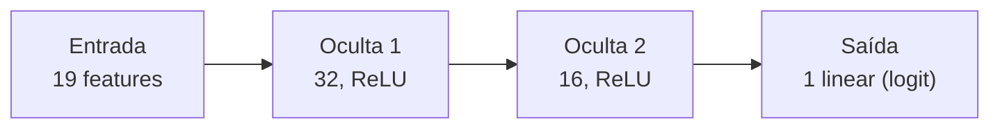
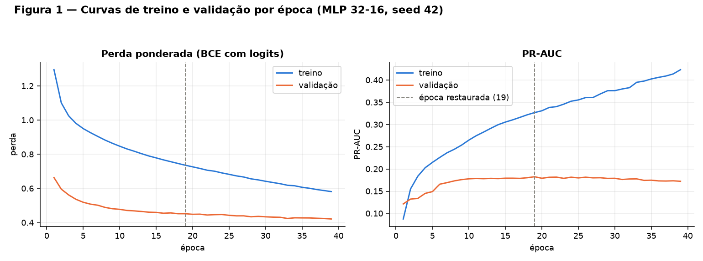
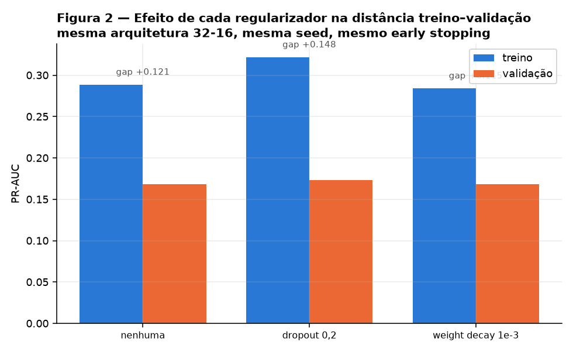
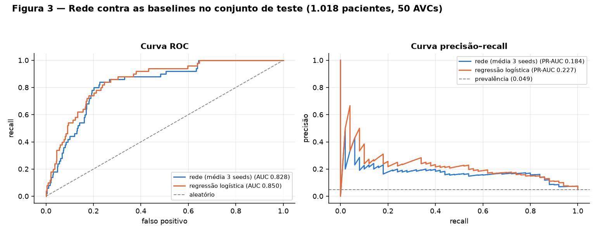
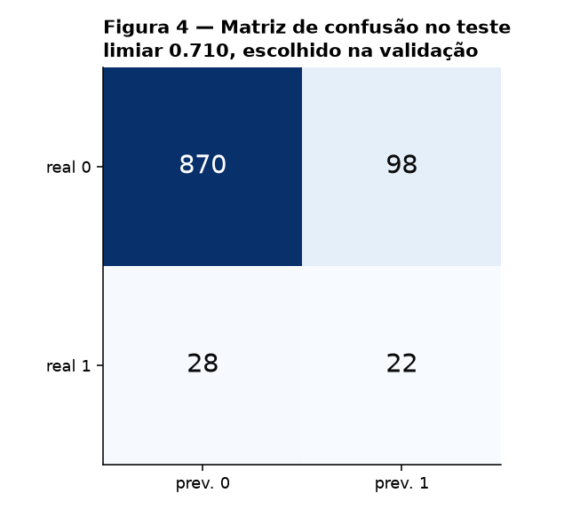
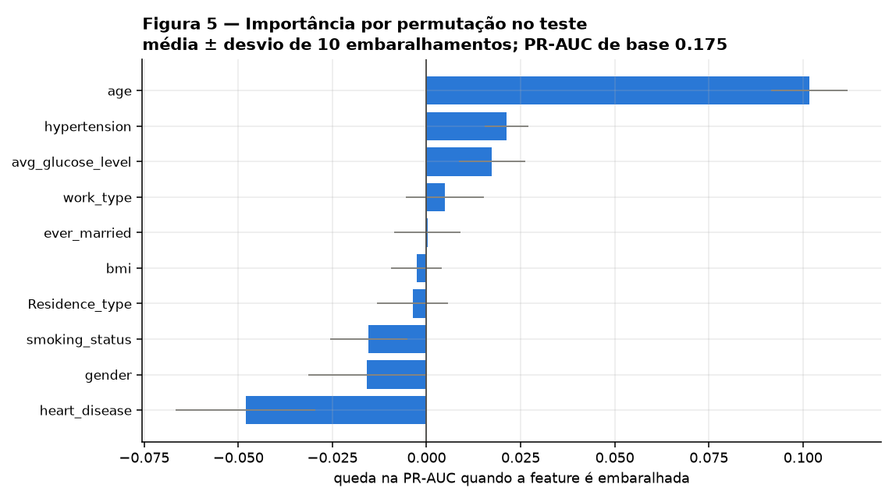
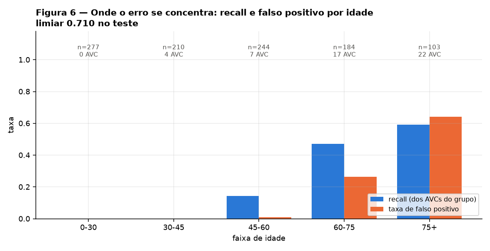

# 2. Classificação

!!! abstract "Entrega 2 de 3 do [Projeto](../index.md)"

    [Projects → Classification](https://insper.github.io/ann-dl/){:target='_blank'}

!!! info "Equipe"

    | Nome completo | GitHub |
    |---------------|--------|
    | João Gabriel Faraco | [Joao-Gabriel05](https://github.com/Joao-Gabriel05) |
    | Henrique Turco | |
    | Leonardo Freitas | [leosfreitas](https://github.com/leosfreitas) |

    Dataset, decisões e status: [página do projeto](../index.md).

!!! danger "O resultado desta entrega é negativo — e é o resultado"

    A MLP **não superou a regressão logística**. No teste, a rede fica em PR-AUC
    **0,167 ± 0,007** contra **0,205** da logística: 18,6% *abaixo*, quando o critério fixado
    antes do treino pedia 15% acima. O relatório explica por quê — 159 AVCs no treino
    interno para 3.393 parâmetros — e por que, neste dataset, o modelo que a equipe
    recomendaria para triagem é o linear. Todo número abaixo sai de
    [`code/results.json`](code/results.json), gerado por [`code/run.py`](#codigo).

## Passo 0 · Ponto de partida

O pipeline do [EDA](../eda/index.md#4c-pipeline) é **importado, não reescrito**:
`run.py` faz `from preprocessing import load_raw, clean, split, build_preprocessor` de
`docs/projects/eda/code/`. O split externo é o mesmo das três entregas — 80/20
estratificado, `random_state=42` — e sobre ele a validação é recortada **do treino**:

| Partição | Linhas | AVCs | Prevalência |
|---|---|---|---|
| Treino interno | 3.255 | 159 | 4,89% |
| Validação | 814 | 40 | 4,91% |
| Teste | 1.018 | 50 | 4,91% |

O pré-processador é reajustado **só no treino interno** (3.255 linhas), não nas 4.069 do
treino externo. Sem isso, as medianas de imputação e os quantis de winsorização teriam
visto a validação, e a seleção de hiperparâmetros do passo 4 estaria escolhendo sobre dados
que o modelo já conhecia. Saída: 19 features, 0 NaN em treino e teste. O `bmi` ausente
entra imputado pela mediana do treino interno; a ausência em si não é feature (ver
[EDA, 1B](../eda/index.md#1b-quality)).

!!! note "Métrica e critério, fixados antes de treinar"

    **Métrica principal: PR-AUC (average precision) no teste.**

    Com 19,4 : 1 de desbalanceamento, a acurácia é inútil — o classificador trivial marca
    95,09% sem detectar um único AVC. A ROC-AUC também engana: ela se infla com os 968
    negativos do teste, e um modelo pode ter ROC-AUC 0,85 continuando impraticável na
    triagem. A PR-AUC só sobe se os positivos subirem no *ranking*.

    **Critério de sucesso: PR-AUC de teste pelo menos 15% acima da melhor baseline, na
    média de 3 seeds.** Secundárias: recall da classe 1, macro F1, ROC-AUC.

## Passo 1 · Baselines

Mesmo pipeline, mesmas features, avaliadas na validação (limiar 0,5):

| Modelo | PR-AUC | ROC-AUC | Recall (AVC) | Precisão (AVC) | Parâmetros |
|---|---|---|---|---|---|
| `DummyClassifier(most_frequent)` | 0,049 | 0,500 | 0,00 | 0,00 | 0 |
| Regressão logística (`class_weight="balanced"`) | **0,227** | **0,875** | 0,88 | 0,14 | 20 |

A PR-AUC do trivial (0,049) é exatamente a prevalência: é o chão de qualquer modelo que não
ordene nada. A leitura que importa é a **segunda linha**: 20 parâmetros em um modelo linear
já alcançam 0,227. Esse é o número que a rede precisa bater, e o EDA já tinha avisado por
quê — `age` sozinha tem AUC 0,833. O sinal deste dataset é largamente monotônico na idade, o
que é precisamente o regime em que um modelo linear é difícil de superar.

## Passo 2 · A rede

MLP densa, duas camadas ocultas, escrita em Keras/TensorFlow. Esta é a rede **de partida**
(passos 2 e 3); a busca do passo 4 troca a arquitetura pela 64-32 que vai ao teste.



| | Escolha | Por quê |
|---|---------|---------|
| Camadas ocultas | 32 → 16 | A capacidade tem de ser contada contra os **159 positivos** do treino interno, não contra as 3.255 linhas. 32-16 dá 19·32+32 + 32·16+16 + 16+1 = **1.185 parâmetros**, ou **7,5 por AVC de treino** — já desconfortável. |
| Ativação | ReLU | Sem saturação no gradiente; as entradas chegam padronizadas (média 0, desvio 1) pelo `StandardScaler` final do pipeline do EDA. |
| Inicialização | He uniform | Par padrão da ReLU: mantém a variância do sinal estável de camada em camada. |
| Saída | **1 neurônio linear** | Binário: um logit basta. |
| Perda | `BinaryCrossentropy(from_logits=True)` | Equivalente Keras do `BCEWithLogitsLoss`. O sigmoide vive **dentro** da perda, o que mantém o log-sum-exp estável em vez de deixar um sigmoide saturado arredondar para 0 ou 1 e zerar o gradiente. |
| Desbalanceamento | `class_weight={0: 1, 1: 19.47}` | Peso = negativos/positivos do treino. Sem ele a rede minimiza a perda prevendo sempre 0. Aplicado **só no treino** — validação e teste mantêm a prevalência real. |

**1.185 parâmetros para 3.255 linhas (0,36 por linha) e 159 positivos (7,5 por positivo).**
A segunda razão é a que governa este problema: a rede tem mais graus de liberdade por evento
positivo do que o dataset pode sustentar, e é isso que o passo 4 tenta conter e o passo 5
mostra que não foi contido o suficiente.

## Passo 3 · Treinamento

| | Escolha | Por quê |
|---|---------|---------|
| Otimizador | Adam, `lr = 1e-3` | Passo adaptativo por parâmetro: funciona bem com o `lr` padrão, enquanto o SGD com momentum exigiria ajuste fino de `lr` que o orçamento de validação não paga. Quando há weight decay (passo 4), usa-se AdamW, a versão do Adam com decay desacoplado. |
| Batch size | 64 | 51 passos por época. Em lotes muito maiores, a maioria dos batches não contém **nenhum** positivo (4,89% × 128 ≈ 6), e o gradiente da classe de interesse chega esparso. |
| Épocas | até 200, early stopping | Nunca chegou perto: parou na época 35. |
| Early stopping | `patience=20`, monitor `val_pr_auc` (modo max), `restore_best_weights=True` | **O monitor não é a perda.** Com 40 positivos na validação a perda ponderada oscila muito de época a época; o que a triagem precisa é da *ordenação* dos pacientes, que é exatamente o que a PR-AUC mede. |


/// caption
**Figura 1** — Perda ponderada e PR-AUC por época. A linha tracejada marca a época 15,
restaurada pelo early stopping.
///

A leitura da curva: a validação para de melhorar na **época 15** e o treino continua
descendo por 20 épocas até a paciência estourar, na 35. Nos pesos restaurados, a PR-AUC de
treino é 0,289 contra 0,168 na validação — uma distância de **+0,121**. Não é ruído: é a
rede memorizando 159 positivos. O early stopping restaurou os pesos da época 15, e é sobre
esse ponto que o passo 4 trabalha.

## Passo 4 · Regularização e hiperparâmetros

### 4A. Cada técnica, isolada

Mesma arquitetura 32-16, mesma seed, mesmo early stopping; só a regularização muda:

| Técnica | PR-AUC treino | PR-AUC validação | Distância | Melhor época |
|---|---|---|---|---|
| nenhuma | 0,289 | 0,168 | +0,121 | 15 |
| dropout 0,2 | 0,322 | **0,173** | +0,148 | 49 |
| weight decay 1e-3 (AdamW) | 0,284 | 0,169 | **+0,115** | 14 |


/// caption
**Figura 2** — PR-AUC de treino e validação por técnica, com a distância anotada.
///

Duas leituras:

1. **Dropout 0,2 sobe a validação, mas abre a distância.** A validação vai de 0,168 para
   0,173, e o treino sobe mais (0,289 → 0,322): com o ruído do dropout, o early stopping
   deixa a rede treinar até a época 49, e ela usa essas épocas para se ajustar ainda mais
   ao treino. Distância +0,121 → +0,148.
2. **Weight decay a 1e-3, sozinho, quase não faz nada** (0,168 → 0,169; distância
   +0,115). A penalização L2 nessa magnitude é pequena demais frente ao sinal.

Na 32-16, nenhuma técnica isolada move a validação mais que 0,005. O ganho do passo 4 vem
da combinação de mais largura com dropout 0,3–0,4 e weight decay (4B).

### 4B. Busca, escolhida na validação

Nove configurações (a rubrica pede 8 ou mais), variando largura/profundidade, dropout,
weight decay, learning rate e batch size; todas com ReLU. Ordenadas por PR-AUC de validação:

| # | Arquitetura | Dropout | Weight decay | LR | Batch | Params | PR-AUC val |
|---|---|---|---|---|---|---|---|
| 4 | 64-32 | 0,3 | 1e-3 | 1e-3 | 64 | 3.393 | **0,230** |
| 7 | 128-64 | 0,4 | 1e-2 | 5e-4 | 128 | 10.881 | 0,224 |
| 5 | 64-32 | 0,3 | 1e-2 | 5e-4 | 64 | 3.393 | 0,220 |
| 9 | 16-8 | 0,2 | 1e-3 | 1e-3 | 32 | 465 | 0,201 |
| 1 | 16 | 0,0 | 0 | 1e-3 | 64 | 337 | 0,196 |
| 6 | 64-32-16 | 0,3 | 1e-3 | 1e-3 | 128 | 3.905 | 0,195 |
| 3 | 32-16 | 0,2 | 1e-3 | 1e-3 | 64 | 1.185 | 0,173 |
| 2 | 32-16 | 0,0 | 0 | 1e-3 | 64 | 1.185 | 0,168 |
| 8 | 32-16 | 0,1 | 1e-4 | 3e-3 | 32 | 1.185 | 0,163 |

A vencedora é a **cfg 4**: 64-32 com dropout 0,3 e weight decay 1e-3, **3.393 parâmetros**
(21 por positivo). O padrão da tabela é consistente — as três primeiras são as redes mais
largas, todas com dropout de 0,3 ou 0,4 e weight decay, e as três últimas são a 32-16,
qualquer que seja a regularização (0,163–0,173).

E um aviso que o passo 5 confirma: **a vencedora faz 0,230 na validação, e a logística de
20 parâmetros faz 0,227 no mesmo recorte.** A busca inteira ganhou 0,003 de PR-AUC sobre o
modelo linear, com 170 vezes mais parâmetros. A cfg 1, uma única camada de 16 unidades e 337
parâmetros, fica em 0,196.

### 4C. Limiar, escolhido na validação

O limiar não é 0,5. Ele foi varrido em 193 valores na **validação** e escolhido por **F2**,
que pesa recall o dobro da precisão:

| Limiar | Recall (val) | Precisão (val) |
|---|---|---|
| 0,500 | 0,900 | 0,129 |
| **0,710** (escolhido) | **0,625** | **0,221** |

A justificativa de custo é clínica e assimétrica: num instrumento de **triagem**, um falso
negativo é um paciente de risco mandado para casa, e um falso positivo é um exame
confirmatório a mais. F2 codifica essa assimetria sem fingir que ela é infinita — a 0,5 o
recall sobe para 0,900, mas a precisão cai a 0,129, e uma fila de triagem em que 87 de cada
100 encaminhados não têm nada deixa de ser usada.

## Passo 5 · Avaliação no teste

O teste foi tocado **uma única vez**, depois de fechadas arquitetura, regularização e limiar
na validação. Três seeds (42, 7, 2024), mesma configuração vencedora; rede e logística no
mesmo limiar, 0,710:

| Métrica | Trivial | Logística | **Rede (3 seeds)** |
|---|---|---|---|
| **PR-AUC** | 0,049 | **0,205** | **0,167 ± 0,007** |
| ROC-AUC | 0,500 | **0,844** | 0,813 ± 0,007 |
| Acurácia | 0,951 | 0,834 | 0,872 ± 0,017 |
| Macro F1 | 0,487 | **0,602** | 0,597 ± 0,016 |
| Recall (AVC) | 0,00 | **0,720** | 0,467 ± 0,023 |
| Precisão (AVC) | 0,00 | 0,188 | 0,185 ± 0,022 |
| F1 (AVC) | 0,00 | **0,299** | 0,264 ± 0,023 |

Seeds individuais da rede: PR-AUC 0,159 / 0,172 / 0,169.

A rede só ganha em acurácia (0,872 contra 0,834), e pelo motivo errado: ela encaminha menos
pacientes, então acerta mais negativos e perde mais AVCs — recall de 0,467 contra 0,720.


/// caption
**Figura 3** — ROC e precisão–recall no teste (1.018 pacientes, 50 AVCs), rede contra as
baselines. A linha tracejada da direita é a prevalência, 0,049.
///


/// caption
**Figura 4** — Matriz de confusão da rede no teste (média dos scores das 3 seeds), limiar
0,710: 22 AVCs detectados, 28 perdidos, 98 falsos positivos.
///

!!! failure "O critério do passo 0 não foi atendido"

    Pedia PR-AUC de teste **15% acima** da melhor baseline. A rede ficou **18,6% abaixo**:
    0,167 ± 0,007 contra 0,205 da logística. A logística também ganha em ROC-AUC (0,844 vs
    0,813), recall (0,720 vs 0,467) e F1 da classe positiva (0,299 vs 0,264), com 20
    parâmetros contra 3.393.

A diferença entre validação e teste é o ponto mais instrutivo da entrega. A cfg 4 marcou
**0,230 na validação** e **0,167 no teste** — uma queda de 0,063. A logística, que não
passou por seleção nenhuma, cai bem menos: de 0,227 para 0,205. A validação tem **40
positivos**; escolher a melhor de nove configurações sobre 40 eventos não mede
generalização, mede qual configuração acertou o ruído daquele recorte. E a queda não é
variação de seed: o desvio entre seeds é de ±0,007, e a queda é nove vezes maior. Em outras
palavras: a busca do passo 4 produziu um vencedor otimista, e o teste cobrou a conta. O
caminho correto aqui teria sido validação cruzada estratificada em k dobras sobre o treino,
e não um único recorte de 814 linhas — é a mudança que a equipe faria primeiro.

## Passo 6 · Análise de erro

### Importância por permutação

Cada feature **bruta** foi embaralhada 10 vezes e re-passada pelo pipeline ajustado — não as
colunas one-hot isoladas, que criariam pacientes impossíveis (um paciente com dois
`work_type`). A queda medida é na PR-AUC de teste da média das 3 seeds (base 0,175):

| Feature | Queda na PR-AUC | Desvio |
|---|---|---|
| `age` | **0,1017** | ± 0,0102 |
| `hypertension` | 0,0212 | ± 0,0057 |
| `avg_glucose_level` | 0,0174 | ± 0,0088 |
| `work_type` | 0,0048 | ± 0,0103 |
| `ever_married` | 0,0002 | ± 0,0088 |
| `bmi` | −0,0026 | ± 0,0067 |
| `Residence_type` | −0,0037 | ± 0,0095 |
| `smoking_status` | −0,0154 | ± 0,0103 |
| `gender` | −0,0159 | ± 0,0155 |
| `heart_disease` | **−0,0480** | ± 0,0186 |


/// caption
**Figura 5** — Queda na PR-AUC de teste ao embaralhar cada feature, média ± desvio de 10
repetições.
///

Isto confirma o diagnóstico do EDA e fecha o argumento da entrega. `age` responde por
**0,102 dos 0,175** de PR-AUC — mais da metade. `hypertension` e `avg_glucose_level` vêm em
seguida, com cerca de um quinto disso cada, e **tudo a partir de `work_type` está dentro do
próprio ruído ou é negativo**. O caso extremo é `heart_disease`: embaralhá-la *melhora* a
PR-AUC em 0,048, o que significa que a rede dá a essa coluna um peso que o teste não
sustenta (hipótese 3, abaixo).

O EDA mediu `age` sozinha com AUC **0,833**. A rede inteira, com 3.393 parâmetros e 19
features, faz ROC-AUC **0,813**. **A rede reconstruiu a idade e pouco além dela** — e pagou
o custo de variância por isso. É a resposta direta à pergunta do enunciado: não, a rede não
aprendeu nada que os modelos simples não aprendam.

### Erro por subgrupo

| Dimensão | Nível | n | AVCs | Recall | Taxa de FP |
|---|---|---|---|---|---|
| Idade | 0–30 | 277 | 0 | — | 0,000 |
| Idade | 30–45 | 210 | 4 | 0,000 | 0,000 |
| Idade | 45–60 | 244 | 7 | 0,143 | 0,008 |
| Idade | 60–75 | 184 | 17 | 0,471 | 0,263 |
| Idade | 75+ | 103 | 22 | 0,591 | **0,642** |
| `hypertension` | 1 | 101 | 15 | 0,867 | 0,477 |
| `heart_disease` | 1 | 67 | 12 | 0,667 | **0,582** |
| `heart_disease` | 0 | 951 | 38 | 0,368 | 0,072 |


/// caption
**Figura 6** — Recall e taxa de falso positivo por faixa de idade, limiar 0,710.
///

Três padrões, com hipótese para cada:

1. **O modelo é um detector de idade com limiar perto dos 60 anos.** Abaixo de 60 ele
   detecta 1 dos 11 AVCs (recall 0,000–0,143); acima, 0,47–0,59. A taxa de falso positivo
   acompanha: 0,642 acima de 75 anos. Ou seja, acima dos 75 a rede encaminha **64 de cada
   100 pacientes sem AVC**, e ainda perde 9 dos 22 casos. Na faixa em que a triagem mais
   importa, a saída separa mal os dois grupos.
2. **Os 28 falsos negativos são, sobretudo, AVCs em pacientes sem comorbidade.** Os cinco
   de menor score têm 49, 45, 32, 39 e 47 anos, glicose entre 64 e 105, sem hipertensão nem
   doença cardíaca — e nenhum dos oito de menor score tem hipertensão ou doença cardíaca.
   São exatamente os casos que as features disponíveis não distinguem de um negativo — o
   EDA já havia registrado AVCs a 1,32 e 14 anos. Nenhuma arquitetura resolve isso; é um
   limite do dataset, não do modelo.
3. **`heart_disease = 1` virou o gatilho dos falsos positivos.** Os **oito** falsos
   positivos de maior score têm doença cardíaca (todos homens, de 64 a 81 anos). No
   subgrupo com `heart_disease = 1`, a taxa de FP é 0,582, oito vezes a do resto (0,072),
   e a permutação mostra que a rede confia nessa coluna mais do que o teste justifica
   (−0,048). Hipótese: depois do `StandardScaler`, `heart_disease = 1` vale +4,30, a maior
   entrada do pipeline (EDA, 4A), e com poucos pacientes com doença cardíaca no treino
   (209 no treino externo, pelo EDA) a rede aprende para ela um peso grande demais.

## Passo 7 · Conclusão

**A rede não se justifica neste dataset.** O critério fixado antes de treinar — 15% de
ganho em PR-AUC — não foi atendido nem de longe: a rede ficou 18,6% abaixo da regressão
logística, perdendo também em ROC-AUC, recall e F1 da classe positiva, com 3.393 parâmetros
contra 20. Entre os modelos testados, o que a equipe recomendaria para uma triagem é o
**linear**, e a recomendação não é um empate técnico: é uma diferença consistente nas três
seeds (0,159, 0,172 e 0,169, todas abaixo de 0,205).

A razão é dimensional, não de engenharia. São **159 AVCs no treino interno**. Um modelo
com 7,5 (rede de partida) a 21 (vencedora) parâmetros por evento positivo tem graus de
liberdade para memorizar esses casos, e foi o que ele fez — a distância treino–validação de
+0,121 sem regularização, a queda de 0,230 (validação) para 0,167 (teste) e o peso
excessivo em `heart_disease` são três medidas do mesmo fato. Somado a isso, o sinal
disponível é majoritariamente monotônico em `age` (0,102 dos 0,175 de PR-AUC; AUC 0,833
sozinha no EDA), que é o regime em que a não linearidade não tem o que oferecer.

### Limitações

- **A seleção do passo 4 é otimista.** Nove configurações escolhidas sobre 40 positivos de
  validação. O número honesto da busca não é 0,230, é 0,167. A correção é validação cruzada
  estratificada em k dobras — a primeira mudança a fazer.
- **O teste tem 50 positivos.** Um intervalo de confiança sobre recall 0,467 com 50 eventos
  é largo; a conclusão de que a logística é melhor é sustentada pela consistência entre as
  três seeds e pelas métricas secundárias, não por um teste de hipótese.
- **O limiar foi escolhido para a rede.** A logística foi avaliada no mesmo 0,710; com um
  limiar próprio ela poderia trocar recall por precisão de outro jeito. A PR-AUC, que não
  depende de limiar, já a coloca à frente.
- **`smoking_status` é "Unknown" em 30,2%** dos pacientes (682 deles menores de 18 anos, pelo
  EDA). O que a permutação atribui a fumo é, em parte, idade.
- **Não houve calibração.** Os scores são usados para ordenar e limiarizar, não como
  probabilidades. Dizer "este paciente tem 71% de chance de AVC" não é sustentado por nada
  aqui.

### Uso responsável

O dataset é licenciado para **uso educacional** e a fonte é confidencial — não há
documentação de como os pacientes foram recrutados, de que população vêm, nem de quando. Um
modelo treinado aqui não deve ser usado para decidir sobre pessoas. Três riscos concretos,
medidos acima:

- **Abaixo dos 60 anos o modelo detecta 1 de 11 AVCs** (recall 0,000–0,143). Um instrumento
  assim, usado como triagem, erra sistematicamente nos pacientes mais jovens — e são os
  casos em que o diagnóstico precoce muda mais o desfecho.
- **A taxa de falso positivo chega a 0,642 acima dos 75 anos** e a 0,582 em quem tem doença
  cardíaca. Nesses grupos o modelo encaminha a maioria; o custo recai sobre o sistema de
  saúde e sobre pacientes submetidos a exames desnecessários.
- **Há disparidade entre gêneros não explicada por risco.** Homens são mais encaminhados
  (taxa de FP 0,138 contra 0,075 nas mulheres) e mais detectados (recall 0,500 contra
  0,406), sem que `gender` tenha importância por permutação (−0,016). Com 18 AVCs
  masculinos e 32 femininos no teste, a diferença de recall é incerta, mas qualquer uso real
  exigiria auditá-la antes de qualquer outra coisa.

### Tabela resumo

| | |
|---|---|
| Tarefa | Classificação binária de `stroke` |
| Dataset | Stroke Prediction (Kaggle), 5.087 linhas após limpeza, 19 features |
| Split | 80/20 estratificado, `random_state=42`; validação 20% do treino |
| Métrica principal | PR-AUC no teste |
| Critério fixado | ≥ 15% acima da melhor baseline (3 seeds) |
| Melhor baseline | Regressão logística, PR-AUC **0,205** |
| Rede escolhida | MLP 64-32, ReLU, dropout 0,3, weight decay 1e-3, AdamW lr 1e-3, batch 64, 3.393 params |
| Perda | `BinaryCrossentropy(from_logits=True)` com `class_weight` 1 : 19,47 |
| Limiar | 0,710, por F2 na validação |
| **Resultado da rede** | PR-AUC **0,167 ± 0,007**; ROC-AUC 0,813; recall 0,467; precisão 0,185 |
| **Critério atendido?** | **Não** — 18,6% abaixo da baseline |
| Feature dominante | `age` (0,102 de 0,175 de PR-AUC por permutação) |
| Conclusão | O modelo linear é o recomendado; 159 positivos de treino não sustentam a MLP |

## Código {#codigo}

Roda de um clone limpo, em ~5 min de CPU:

```shell
cd docs/projects/classification/code && python run.py
```

`network.py` — a rede e o laço de treino:

```python
--8<-- "docs/projects/classification/code/network.py"
```

`run.py` — passos 0 a 6; escreve `results.json` e as seis figuras:

```python
--8<-- "docs/projects/classification/code/run.py"
```

## Referências

- fedesoriano. **Stroke Prediction Dataset**. Kaggle, 2021.
  <https://www.kaggle.com/datasets/fedesoriano/stroke-prediction-dataset>
- Saito, T.; Rehmsmeier, M. **The Precision-Recall Plot Is More Informative than the ROC
  Plot When Evaluating Binary Classifiers on Imbalanced Datasets**. PLoS ONE, 2015.
- Srivastava, N. et al. **Dropout: A Simple Way to Prevent Neural Networks from
  Overfitting**. JMLR 15, 2014.
- Loshchilov, I.; Hutter, F. **Decoupled Weight Decay Regularization** (AdamW). ICLR 2019.
