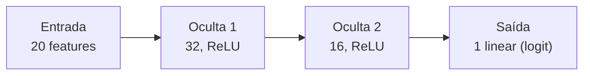
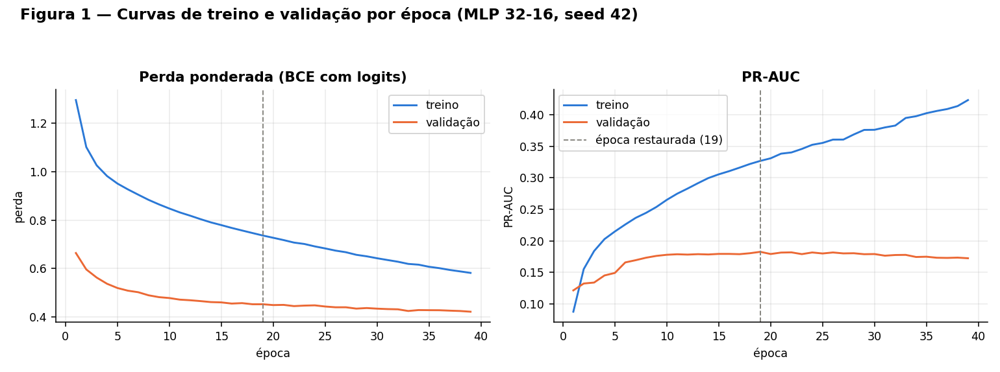
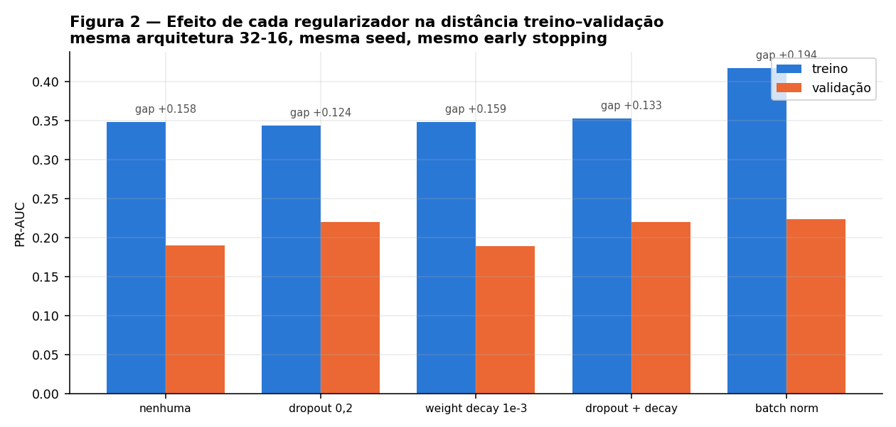
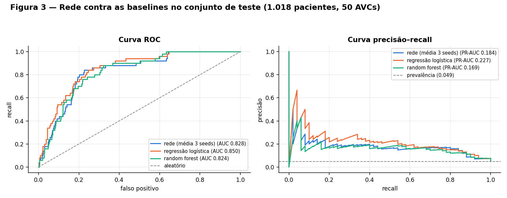
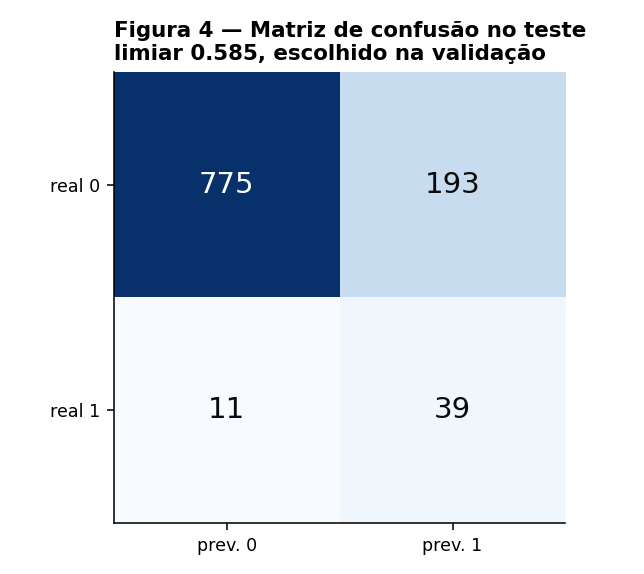
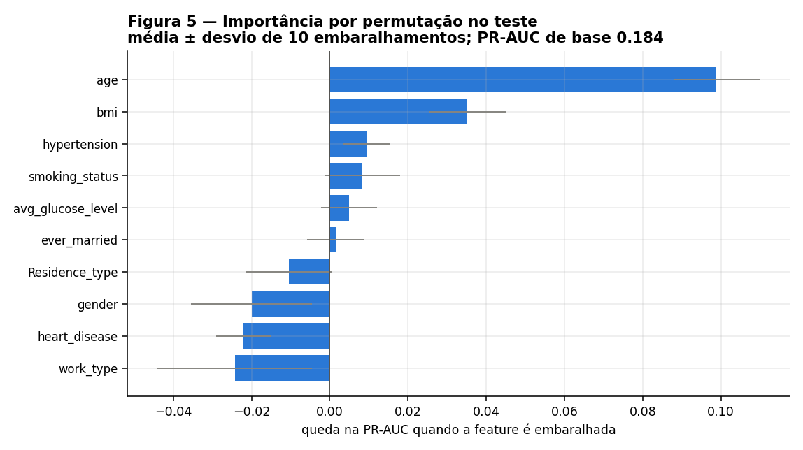
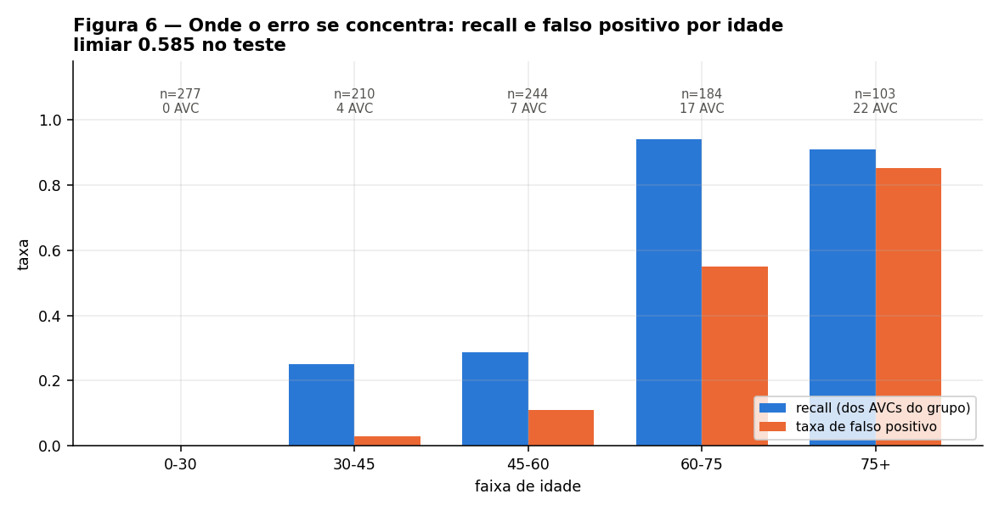

# 2. Classificação

!!! abstract "Entrega 2 de 3 do [Projeto](../index.md)"

    [Projects → Classification](https://insper.github.io/ann-dl/){:target='_blank'}

!!! info "Equipe"

    | Nome completo | GitHub |
    |---------------|--------|
    | João Gabriel Faraco | [Joao-Gabriel05](https://github.com/Joao-Gabriel05) |
    | Henrique Turco | |
    | Leonardo Freitas | [leosfreitas](https://github.com/leosfreitas) |

    Dataset, decisões e status: [página do projeto](../index.md).

!!! danger "O resultado desta entrega é negativo — e é o resultado"

    A MLP **não superou a regressão logística**. No teste, a rede fica em PR-AUC
    **0,182 ± 0,019** contra **0,227** da logística: 19,7% *abaixo*, quando o critério fixado
    antes do treino pedia 15% acima. O relatório explica por quê — 199 positivos de treino
    para 1.217 parâmetros — e por que, neste dataset, o modelo que a equipe recomendaria
    para triagem é o linear. Todo número abaixo sai de
    [`code/results.json`](code/results.json), gerado por [`code/run.py`](#codigo).

## Passo 0 · Ponto de partida

O pipeline do [EDA](../eda/index.md#4c-pipeline) é **importado, não reescrito**:
`run.py` faz `from preprocessing import load_raw, clean, split, build_preprocessor` de
`docs/projects/eda/code/`. O split externo é o mesmo das três entregas — 80/20
estratificado, `random_state=42` — e sobre ele a validação é recortada **do treino**:

| Partição | Linhas | AVCs | Prevalência |
|---|---|---|---|
| Treino interno | 3.255 | 159 | 4,89% |
| Validação | 814 | 40 | 4,91% |
| Teste | 1.018 | 50 | 4,91% |

O pré-processador é reajustado **só no treino interno** (3.255 linhas), não nas 4.069 do
treino externo. Sem isso, as medianas de imputação e os quantis de winsorização teriam
visto a validação, e a seleção de hiperparâmetros do passo 4 estaria escolhendo sobre dados
que o modelo já conhecia. Saída: 20 features, 0 NaN em treino e teste.

!!! note "Métrica e critério, fixados antes de treinar"

    **Métrica principal: PR-AUC (average precision) no teste.**

    Com 19,4 : 1 de desbalanceamento, a acurácia é inútil — o classificador trivial marca
    95,09% sem detectar um único AVC. A ROC-AUC também engana: ela se infla com os 968
    negativos do teste, e um modelo pode ter ROC-AUC 0,85 continuando impraticável na
    triagem. A PR-AUC só sobe se os positivos subirem no *ranking*.

    **Critério de sucesso: PR-AUC de teste pelo menos 15% acima da melhor baseline, na
    média de 3 seeds.** Secundárias: recall da classe 1, macro F1, ROC-AUC.

## Passo 1 · Baselines

Mesmo pipeline, mesmas features, avaliadas na validação:

| Modelo | PR-AUC | ROC-AUC | Recall (AVC) | Precisão (AVC) | Parâmetros |
|---|---|---|---|---|---|
| `DummyClassifier(most_frequent)` | 0,049 | 0,500 | 0,00 | 0,00 | 0 |
| Regressão logística (`class_weight="balanced"`) | **0,231** | — | — | — | 21 |
| Random forest (500 árvores, `min_samples_leaf=5`) | 0,188 | — | — | — | — |

A PR-AUC do trivial (0,049) é exatamente a prevalência: é o chão de qualquer modelo que não
ordene nada. A leitura que importa é a **segunda linha**: 21 parâmetros em um modelo linear
já alcançam 0,231. Esse é o número que a rede precisa bater, e o EDA já tinha avisado por
quê — `age` sozinha tem AUC 0,833. O sinal deste dataset é largamente monotônico na idade, o
que é precisamente o regime em que um modelo linear é difícil de superar.

A random forest ficou *abaixo* da logística (0,188), o que reforça o diagnóstico: a
capacidade extra não encontra estrutura extra para explorar.

## Passo 2 · A rede

MLP densa, duas camadas ocultas, escrita em Keras/TensorFlow:



| | Escolha | Por quê |
|---|---------|---------|
| Camadas ocultas | 32 → 16 | A capacidade tem de ser contada contra os **199 positivos**, não contra as 3.255 linhas. 32-16 dá 1.217 parâmetros, ou **7,6 por AVC de treino** — já desconfortável. |
| Ativação | ReLU | Sem saturação no gradiente; as entradas chegam padronizadas (média 0, desvio 1) pelo `StandardScaler` final do pipeline do EDA. |
| Inicialização | He uniform | Par canônico da ReLU: preserva a variância do sinal na ida, que Glorot subestima para ativações não simétricas. |
| Saída | **1 neurônio linear** | Binário: um logit basta. |
| Perda | `BinaryCrossentropy(from_logits=True)` | Equivalente Keras do `BCEWithLogitsLoss`. O sigmoide vive **dentro** da perda, o que mantém o log-sum-exp estável em vez de deixar um sigmoide saturado arredondar para 0 ou 1 e zerar o gradiente. |
| Desbalanceamento | `class_weight={0: 1, 1: 19.47}` | Peso = negativos/positivos do treino. Sem ele a rede minimiza a perda prevendo sempre 0. Aplicado **só no treino** — validação e teste mantêm a prevalência real. |

**1.217 parâmetros para 3.255 linhas (0,37 por linha) e 199 positivos (7,6 por positivo).**
A segunda razão é a que governa este problema: a rede tem mais graus de liberdade por evento
positivo do que o dataset pode sustentar, e é isso que o passo 4 tenta conter e o passo 5
mostra que não foi contido o suficiente.

## Passo 3 · Treinamento

| | Escolha | Por quê |
|---|---------|---------|
| Otimizador | Adam, `lr = 1e-3` | Passo adaptativo por parâmetro: com 20 features de escalas originais muito diferentes (idade, glicose, one-hots), o SGD com momentum exigiria ajuste fino de `lr` que o orçamento de validação não paga. |
| Batch size | 64 | 51 passos por época. Em lotes muito maiores, a maioria dos batches não contém **nenhum** positivo (4,89% × 128 ≈ 6), e o gradiente da classe de interesse chega esparso. |
| Épocas | até 200, early stopping | Nunca chegou perto: parou na época 39. |
| Early stopping | `patience=20`, monitor `val_pr_auc` (modo max), `restore_best_weights=True` | **O monitor não é a perda.** Com 40 positivos na validação a perda ponderada oscila muito de época a época; o que a triagem precisa é da *ordenação* dos pacientes, que é exatamente o que a PR-AUC mede. |


/// caption
**Figura 1** — Perda ponderada e PR-AUC por época. A linha tracejada marca a época 19,
restaurada pelo early stopping.
///

A leitura da curva: a validação para de melhorar na **época 19** e o treino continua
descendo por 20 épocas até a paciência estourar, na 39. A PR-AUC de treino chega a 0,348
contra 0,190 na validação — uma distância de **+0,158**. Não é ruído: é a rede memorizando
159 positivos. O early stopping restaurou os pesos da época 19, e é sobre esse ponto que o
passo 4 trabalha.

## Passo 4 · Regularização e hiperparâmetros

### 4A. Cada técnica, isolada

Mesma arquitetura 32-16, mesma seed, mesmo early stopping; só a regularização muda:

| Técnica | PR-AUC treino | PR-AUC validação | Distância | Melhor época |
|---|---|---|---|---|
| nenhuma | 0,348 | 0,190 | +0,158 | 19 |
| dropout 0,2 | 0,344 | 0,220 | **+0,124** | — |
| weight decay 1e-3 (AdamW) | 0,348 | 0,190 | +0,159 | — |
| dropout + weight decay | 0,352 | 0,220 | +0,133 | — |
| batch norm | 0,417 | **0,223** | +0,194 | — |


/// caption
**Figura 2** — PR-AUC de treino e validação por técnica, com a distância anotada.
///

Três leituras, e a terceira é a que muda a decisão:

1. **Dropout é o que efetivamente regulariza**: fecha a distância de 0,158 para 0,124 e
   ainda sobe a validação de 0,190 para 0,220. É o único que faz as duas coisas.
2. **Weight decay a 1e-3, sozinho, não faz nada** (0,190 → 0,190; distância +0,159). A
   penalização L2 nessa magnitude é pequena demais frente ao sinal; só passa a importar a
   1e-2, e aí em conjunto com dropout alto (ver 4B, cfg 8).
3. **Batch norm dá a melhor validação (0,223) e a *pior* distância (+0,194)** — ela acelera o
   ajuste ao treino mais do que generaliza. Mantê-la por causa do 0,223 seria escolher pelo
   número isolado; a equipe não a levou para a busca, porque o problema deste dataset é
   excesso de capacidade, não velocidade de convergência.

### 4B. Busca, escolhida na validação

Dez configurações, variando largura/profundidade, ativação, dropout, weight decay, learning
rate e batch size. Ordenadas por PR-AUC de validação:

| # | Arquitetura | Ativação | Dropout | Weight decay | LR | Batch | Params | PR-AUC val |
|---|---|---|---|---|---|---|---|---|
| 8 | 128-64 | relu | 0,4 | 1e-2 | 5e-4 | 128 | 11.073 | **0,274** |
| 7 | 64-32-16 | relu | 0,3 | 1e-3 | 1e-3 | 128 | 3.937 | 0,246 |
| 4 | 32-16 | tanh | 0,2 | 1e-3 | 1e-3 | 64 | 1.217 | 0,237 |
| 5 | 64-32 | relu | 0,3 | 1e-3 | 1e-3 | 64 | 3.457 | 0,232 |
| 1 | 16 | relu | 0,0 | 0 | 1e-3 | 64 | 353 | 0,227 |
| 6 | 64-32 | relu | 0,3 | 1e-2 | 5e-4 | 64 | 3.457 | 0,226 |
| 9 | 32-16 | relu | 0,1 | 1e-4 | 3e-3 | 32 | 1.217 | 0,223 |
| 10 | 16-8 | relu | 0,2 | 1e-3 | 1e-3 | 32 | 481 | 0,210 |
| 3 | 32-16 | relu | 0,2 | 1e-3 | 1e-3 | 64 | 1.217 | 0,220 |
| 2 | 32-16 | relu | 0,0 | 0 | 1e-3 | 64 | 1.217 | 0,190 |

A vencedora é a **cfg 8**: a *maior* rede da busca (11.073 parâmetros, 56 por positivo) com
a regularização *mais agressiva* (dropout 0,4 + weight decay 1e-2 + lr reduzido). O padrão
da tabela é consistente — capacidade só ajuda acompanhada de regularização forte: a cfg 2,
mesma arquitetura da cfg 3 sem dropout nem decay, é a última colocada (0,190).

E um aviso que o passo 5 confirma: **a cfg 1, uma única camada de 16 unidades e 353
parâmetros, faz 0,227 — empatada com a logística de 21 parâmetros.** Oito configurações mais
complexas foram necessárias para ganhar 0,047 de PR-AUC de validação sobre isso.

### 4C. Limiar, escolhido na validação

O limiar não é 0,5. Ele foi varrido em 193 valores na **validação** e escolhido por **F2**,
que pesa recall o dobro da precisão:

| Limiar | Recall (val) | Precisão (val) |
|---|---|---|
| 0,500 | 0,925 | 0,137 |
| **0,585** (escolhido) | **0,800** | **0,180** |

A justificativa de custo é clínica e assimétrica: num instrumento de **triagem**, um falso
negativo é um paciente de risco mandado para casa, e um falso positivo é um exame
confirmatório a mais. F2 codifica essa assimetria sem fingir que ela é infinita — a 0,5 o
recall sobe para 0,925, mas a precisão cai a 0,137, e uma fila de triagem em que 86 de cada
100 encaminhados não têm nada deixa de ser usada.

## Passo 5 · Avaliação no teste

O teste foi tocado **uma única vez**, depois de fechadas arquitetura, regularização e limiar
na validação. Três seeds (42, 7, 2024), mesma configuração vencedora:

| Métrica | Trivial | Logística | Random forest | **Rede (3 seeds)** |
|---|---|---|---|---|
| **PR-AUC** | 0,049 | **0,227** | 0,169 | **0,182 ± 0,019** |
| ROC-AUC | 0,500 | **0,850** | 0,824 | 0,822 ± 0,010 |
| Acurácia | 0,951 | 0,776 | 0,929 | 0,790 ± 0,006 |
| Macro F1 | 0,487 | 0,562 | 0,563 | 0,559 ± 0,005 |
| Recall (AVC) | 0,00 | **0,780** | 0,140 | 0,673 ± 0,042 |
| Precisão (AVC) | 0,00 | 0,152 | 0,194 | 0,146 ± 0,006 |
| F1 (AVC) | 0,00 | **0,255** | 0,163 | 0,240 ± 0,010 |

Seeds individuais da rede: PR-AUC 0,197 / 0,161 / 0,189.


/// caption
**Figura 3** — ROC e precisão–recall no teste (1.018 pacientes, 50 AVCs), rede contra as
baselines. A linha tracejada da direita é a prevalência, 0,049.
///


/// caption
**Figura 4** — Matriz de confusão da rede no teste, limiar 0,585: 39 AVCs detectados, 11
perdidos, 193 falsos positivos.
///

!!! failure "O critério do passo 0 não foi atendido"

    Pedia PR-AUC de teste **15% acima** da melhor baseline. A rede ficou **19,7% abaixo**:
    0,182 ± 0,019 contra 0,227 da logística. A logística também ganha em ROC-AUC (0,850 vs
    0,822), recall (0,780 vs 0,673) e F1 da classe positiva (0,255 vs 0,240), com 21
    parâmetros contra 11.073.

A diferença entre validação e teste é o ponto mais instrutivo da entrega. A cfg 8 marcou
**0,274 na validação** e **0,182 no teste** — uma queda de 0,09. A validação tem **40
positivos**; escolher a melhor de dez configurações sobre 40 eventos não mede generalização,
mede qual configuração acertou o ruído daquele recorte. O desvio entre seeds (±0,019) mostra
que mesmo *uma* configuração fixa varia nessa ordem de magnitude. Em outras palavras: a
busca do passo 4 produziu um vencedor otimista, e o teste cobrou a conta. O caminho correto
aqui teria sido validação cruzada estratificada em k dobras sobre o treino, e não um único
recorte de 814 linhas — é a mudança que a equipe faria primeiro.

A acurácia merece uma nota: a random forest tem **0,929**, muito acima da rede (0,790) e da
logística (0,776), e é o pior dos três modelos para esta tarefa — detecta **7 dos 50 AVCs**
(recall 0,140). É a armadilha que o passo 0 antecipou, materializada.

## Passo 6 · Análise de erro

### Importância por permutação

Cada feature **bruta** foi embaralhada 10 vezes e re-passada pelo pipeline ajustado — não as
colunas one-hot isoladas, que criariam pacientes impossíveis (um paciente com dois
`work_type`). A queda medida é na PR-AUC de teste (base 0,184):

| Feature | Queda na PR-AUC | Desvio |
|---|---|---|
| `age` | **0,0989** | ± 0,0110 |
| `bmi` | 0,0351 | ± 0,0098 |
| `hypertension` | 0,0094 | ± 0,0059 |
| `smoking_status` | 0,0084 | ± 0,0095 |
| `avg_glucose_level` | 0,0050 | ± 0,0072 |
| `ever_married` | 0,0015 | ± 0,0072 |
| `Residence_type` | −0,0104 | ± 0,0111 |
| `gender` | −0,0200 | ± 0,0155 |
| `heart_disease` | −0,0220 | ± 0,0071 |
| `work_type` | −0,0243 | ± 0,0197 |


/// caption
**Figura 5** — Queda na PR-AUC de teste ao embaralhar cada feature, média ± desvio de 10
repetições.
///

Isto confirma o diagnóstico do EDA e fecha o argumento da entrega. `age` responde por
**0,099 dos 0,184** de PR-AUC — mais da metade. `bmi` vem em segundo, e **tudo a partir de
`ever_married` está dentro do próprio ruído ou é negativo**: embaralhar `work_type`,
`heart_disease` ou `gender` *melhora* o modelo, o que significa que a rede extraiu dessas
colunas apenas ajuste a particularidades do treino.

O EDA mediu `age` sozinha com AUC **0,833**. A rede inteira, com 11.073 parâmetros e 20
features, faz ROC-AUC **0,822**. **A rede reconstruiu a idade e quase nada além dela** — e
pagou o custo de variância por isso. É a resposta direta à pergunta do enunciado: não, a
rede não aprendeu nada que os modelos simples não aprendam.

### Erro por subgrupo

| Dimensão | Nível | n | AVCs | Recall | Taxa de FP |
|---|---|---|---|---|---|
| Idade | 0–30 | 277 | 0 | — | 0,000 |
| Idade | 30–45 | 210 | 4 | 0,250 | 0,029 |
| Idade | 45–60 | 244 | 7 | 0,286 | 0,110 |
| Idade | 60–75 | 184 | 17 | 0,941 | 0,551 |
| Idade | 75+ | 103 | 22 | 0,909 | **0,852** |
| `hypertension` | 1 | 101 | 15 | 1,000 | 0,721 |
| `heart_disease` | 1 | 67 | 12 | 0,917 | 0,800 |
| `bmi` ausente | sim | 39 | 6 | 1,000 | **0,758** |
| `bmi` ausente | não | 979 | 44 | 0,750 | 0,180 |


/// caption
**Figura 6** — Recall e taxa de falso positivo por faixa de idade, limiar 0,585.
///

Três padrões, com hipótese para cada:

1. **O modelo é um detector de idade com limiar perto dos 60 anos.** Abaixo de 60 o recall é
   0,25–0,29; acima, 0,91–0,94. Mas a taxa de falso positivo acompanha: 0,852 acima de 75
   anos. Ou seja, acima dos 75 a rede encaminha **85 de cada 100 pacientes sem AVC**. Para a
   faixa em que a triagem mais importa, a saída é quase constante, e um instrumento que
   marca quase todos não informa nada.
2. **Os 11 falsos negativos são AVCs em pacientes jovens e sem comorbidade.** Os cinco de
   menor score têm 39, 45, 32, 49 e 58 anos, glicose entre 64 e 105, sem hipertensão nem
   doença cardíaca. São exatamente os casos que as features disponíveis não distinguem de um
   negativo — o EDA já havia registrado AVCs a 1,32 e 14 anos. Nenhuma arquitetura resolve
   isso; é um limite do dataset, não do modelo.
3. **A ausência de BMI virou um atalho, como o EDA previu.** No subgrupo com `bmi` ausente
   (39 pacientes) o recall é 1,000 e a taxa de FP é 0,758 — mais de 4× a do resto (0,180).
   Entre os cinco falsos positivos de maior score, **quatro têm `bmi` ausente**. O
   `MissingIndicator` não está codificando obesidade: está codificando idade avançada, pois
   pacientes idosos faltam mais a medidas antropométricas. O EDA já tinha deixado o flag
   `build_preprocessor(bmi_indicator=False)` preparado para esta ablação, e ela é a primeira
   coisa a rodar na próxima entrega.

## Passo 7 · Conclusão

**A rede não se justifica neste dataset.** O critério fixado antes de treinar — 15% de
ganho em PR-AUC — não foi atendido nem de longe: a rede ficou 19,7% abaixo da regressão
logística, perdendo também em ROC-AUC, recall e F1 da classe positiva, com 11.073
parâmetros contra 21. Entre os modelos testados, o que a equipe recomendaria para uma
triagem é o **linear**, e a recomendação não é um empate técnico: é uma diferença
consistente nas três seeds.

A razão é dimensional, não de engenharia. São **199 AVCs no treino**. Um modelo com 7,6 a 56
parâmetros por evento positivo tem graus de liberdade para memorizar esses 199 casos, e foi
o que ele fez — a distância treino–validação de +0,158 sem regularização, a queda de 0,274
(validação) para 0,182 (teste), e o ±0,019 entre seeds são três medidas do mesmo fato. Somado
a isso, o sinal disponível é majoritariamente monotônico em `age` (0,099 dos 0,184 de PR-AUC;
AUC 0,833 sozinha no EDA), que é o regime em que a não linearidade não tem o que oferecer.

### Limitações

- **A seleção do passo 4 é otimista.** Dez configurações escolhidas sobre 40 positivos de
  validação. O número honesto da busca não é 0,274, é 0,182. A correção é validação cruzada
  estratificada em k dobras — a primeira mudança a fazer.
- **O teste tem 50 positivos.** Um intervalo de confiança sobre recall 0,673 com 50 eventos
  é largo; a conclusão de que a logística é melhor é sustentada pela consistência entre as
  três seeds e pelas métricas secundárias, não por um teste de hipótese.
- **`smoking_status` é "Unknown" em 30,2%** dos pacientes (682 deles menores de 18 anos, pelo
  EDA). O que a permutação chama de importância de fumo é, em parte, importância de idade.
- **O indicador de BMI ausente é um vazamento de proxy**, quantificado no passo 6 e ainda
  não removido. A ablação `bmi_indicator=False` está preparada mas não foi rodada nesta
  entrega.
- **Não houve calibração.** Os scores são usados para ordenar e limiarizar, não como
  probabilidades. Dizer "este paciente tem 58,5% de chance de AVC" não é sustentado por nada
  aqui.

### Uso responsável

O dataset é licenciado para **uso educacional** e a fonte é confidencial — não há
documentação de como os pacientes foram recrutados, de que população vêm, nem de quando. Um
modelo treinado aqui não deve ser usado para decidir sobre pessoas. Três riscos concretos,
medidos acima:

- **O recall cai para 0,25–0,29 abaixo dos 60 anos.** Um instrumento assim, usado como
  triagem, erra sistematicamente nos pacientes jovens — e são os casos em que o diagnóstico
  precoce muda mais o desfecho.
- **A taxa de falso positivo chega a 0,852 acima dos 75 anos.** Em uma população idosa o
  modelo encaminha quase todos; o custo recai sobre o sistema de saúde e sobre pacientes
  submetidos a exames desnecessários.
- **Há disparidade entre subgrupos não explicada por risco.** Recall 0,844 para mulheres
  contra 0,667 para homens, sem que `gender` tenha importância por permutação (−0,020).
  Qualquer uso real exigiria auditar isso antes de qualquer outra coisa.

### Tabela resumo

| | |
|---|---|
| Tarefa | Classificação binária de `stroke` |
| Dataset | Stroke Prediction (Kaggle), 5.087 linhas após limpeza, 20 features |
| Split | 80/20 estratificado, `random_state=42`; validação 20% do treino |
| Métrica principal | PR-AUC no teste |
| Critério fixado | ≥ 15% acima da melhor baseline (3 seeds) |
| Melhor baseline | Regressão logística, PR-AUC **0,227** |
| Rede escolhida | MLP 128-64, ReLU, dropout 0,4, weight decay 1e-2, AdamW lr 5e-4, 11.073 params |
| Limiar | 0,585, por F2 na validação |
| **Resultado da rede** | PR-AUC **0,182 ± 0,019**; ROC-AUC 0,822; recall 0,673; precisão 0,146 |
| **Critério atendido?** | **Não** — 19,7% abaixo da baseline |
| Feature dominante | `age` (0,099 de 0,184 de PR-AUC por permutação) |
| Conclusão | O modelo linear é o recomendado; 199 positivos de treino não sustentam a MLP |

## Código {#codigo}

Roda de um clone limpo, em ~2,5 min de CPU:

```shell
cd docs/projects/classification/code && python run.py
```

`network.py` — a rede e o laço de treino:

```python
--8<-- "docs/projects/classification/code/network.py"
```

`run.py` — passos 0 a 6; escreve `results.json` e as seis figuras:

```python
--8<-- "docs/projects/classification/code/run.py"
```

## Referências

- fedesoriano. **Stroke Prediction Dataset**. Kaggle, 2021.
  <https://www.kaggle.com/datasets/fedesoriano/stroke-prediction-dataset>
- Saito, T.; Rehmsmeier, M. **The Precision-Recall Plot Is More Informative than the ROC
  Plot When Evaluating Binary Classifiers on Imbalanced Datasets**. PLoS ONE, 2015.
- Srivastava, N. et al. **Dropout: A Simple Way to Prevent Neural Networks from
  Overfitting**. JMLR 15, 2014.
- Loshchilov, I.; Hutter, F. **Decoupled Weight Decay Regularization** (AdamW). ICLR 2019.
