# 1. EDA — Análise Exploratória

!!! abstract "Entrega 1 de 3 do [Projeto](../index.md)"

    [Projects → EDA](https://insper.github.io/ann-dl/){:target='_blank'}

!!! info "Equipe"

    | Nome completo | GitHub |
    |---------------|--------|
    | João Gabriel Faraco | [Joao-Gabriel05](https://github.com/Joao-Gabriel05) |
    | Henrique Turco | |
    | Leonardo Freitas | |

    Dataset, decisões e status: [página do projeto](../index.md).

**Tarefa:** classificação binária — prever `stroke` (o paciente teve AVC) a partir de 10
atributos demográficos e clínicos. Nenhum modelo é treinado nesta entrega.

!!! info "Como reproduzir"

    ```shell
    python3 -m pip install -r requirements.txt   # inclui umap-learn
    python3 docs/projects/eda/code/eda.py           # ~2 min: 12 figuras + code/results.json
    python3 docs/projects/eda/code/preprocessing.py # ajusta o pipeline e reporta shape/NaN
    ```

    O CSV está versionado em `data/`, então tudo roda a partir de um clone limpo, sem
    credencial do Kaggle. Semente fixa em todo o código: `random_state=42`. Cada número
    citado abaixo está em `code/results.json`.

!!! warning "O que é calculado sobre o quê"

    - **1A–1B** descrevem o **arquivo bruto** só com contagens: shape, ausentes, duplicatas,
      faixas, frequências. Nada é ajustado e nada relaciona feature com alvo. As únicas
      exceções são duas propriedades do próprio arquivo, a ordem das linhas e o `id`, que
      nunca entram no modelo.
    - Em seguida, **23 linhas de categorias raras são removidas** (1B). É um filtro por
      valor, sem estatística, que não depende de qual linha cai no treino ou no teste.
    - **1C** usa o arquivo limpo.
    - O **split** acontece na **1D**. Daqui em diante, toda análise e todo `fit` usam
      **só o treino**. As verificações de vazamento que cruzam features com o alvo (1B)
      também foram feitas só no treino.

---

## 0. Proposal

| | |
|---|---|
| **Dataset** | Stroke Prediction Dataset (fedesoriano, Kaggle) |
| **Fonte** | <https://www.kaggle.com/datasets/fedesoriano/stroke-prediction-dataset> |
| **Termos** | "Confidential Source — use only for educational purposes" |
| **Instâncias × colunas** | 5.110 × 12 no bruto (10 features, 1 identificador, 1 alvo); 5.087 após a limpeza |
| **Numéricas / categóricas** | 3 numéricas contínuas / 7 categóricas (2 delas já codificadas 0/1) |
| **Alvo** | `stroke` ∈ {0, 1}, incluído no arquivo |

Atende aos requisitos: tabular e público, mais de 1.000 instâncias e 5 features, mistura
numéricas e categóricas, e não é um dos datasets clássicos vetados. O que o torna
interessante, e não trivial, é a combinação de **forte desbalanceamento** (4,89% de
positivos), uma **feature dominante** (idade) e **ausência informativa** (a falta de IMC é
cinco vezes mais comum entre os casos de AVC). Esses três achados guiam o resto da página.

---

## 1. Initial inspection

### 1A. Data dictionary

**Origem.** Publicado no Kaggle por *fedesoriano*. O autor declara a fonte como
confidencial e não informa instituição, período de coleta nem critério de inclusão. **Uma
linha é um paciente**: `id` é único nas 5.110 linhas.

| Feature | Significado | Tipo | Unidade / valores | Faixa / cardinalidade |
|---------|-------------|------|-------------------|-----------------------|
| `id` | identificador do paciente | identificador | — | 5.110 valores distintos |
| `gender` | sexo | categórica nominal | `Female`, `Male`, `Other` | 3 |
| `age` | idade | numérica contínua | anos | 0,08 – 82 |
| `hypertension` | tem hipertensão | binária | 0 = não, 1 = sim | 2 |
| `heart_disease` | tem doença cardíaca | binária | 0 = não, 1 = sim | 2 |
| `ever_married` | já foi casado(a) | binária nominal | `Yes`, `No` | 2 |
| `work_type` | tipo de ocupação | categórica nominal | `Private`, `Self-employed`, `Govt_job`, `children`, `Never_worked` | 5 |
| `Residence_type` | zona de residência | binária nominal | `Urban`, `Rural` | 2 |
| `avg_glucose_level` | glicose média no sangue | numérica contínua | mg/dL* | 55,12 – 271,74 |
| `bmi` | índice de massa corporal (IMC) | numérica contínua | kg/m² | 10,3 – 97,6 (201 ausentes) |
| `smoking_status` | tabagismo | categórica nominal | `never smoked`, `formerly smoked`, `smokes`, `Unknown` | 4 |
| `stroke` | **alvo**: teve AVC | binária | 0 = não, 1 = sim | 2 |

\* A fonte não informa a unidade da glicose. Inferimos mg/dL pela faixa: em mmol/L, 55–272
seria incompatível com a vida.

**Tipos errados no arquivo bruto.**

- `bmi` grava a ausência como o texto `"N/A"`. Lido sem `na_values=["N/A"]`, a coluna inteira
  vira texto.
- `hypertension` e `heart_disease` são inteiros para o pandas, mas são categorias binárias.
- `id` é inteiro, mas não é uma quantidade.

### 1B. Quality

**Valores ausentes por coluna** (arquivo bruto).

| Coluna | Ausentes | % | Observação |
|--------|---------:|--:|------------|
| `bmi` | 201 | 3,93% | gravados como `"N/A"` |
| `smoking_status` = `Unknown` | 1.544 | 30,22% | ausência **disfarçada** de categoria; 682 desses (44%) são menores de 18 anos |
| demais 10 colunas | 0 | 0% | — |

**Duplicatas.** 0 linhas duplicadas, e também 0 ignorando o `id`.

**Valores impossíveis ou inconsistentes.**

| Verificação | Resultado | Decisão |
|-------------|-----------|---------|
| `gender = Other` | 1 linha | **remover** (abaixo) |
| `work_type = Never_worked` | 22 linhas (0,43%), idades de 13 a 23 anos | **remover** (abaixo) |
| idade fracionária | 115 linhas, todas < 1,88 ano | plausível: bebês registrados em fração de ano; manter |
| `work_type = children` com idade alta | idade máxima do grupo é 16 | consistente |
| casado(a) com menos de 18 anos | 0 | consistente |
| fumante ou ex-fumante com menos de 10 anos | 0 | consistente |
| IMC > 60 | 13 linhas, máximo 97,6 | fisiologicamente extremo, provável erro de registro; *winsorizar* (4A) |
| AVC em criança | o caso mais jovem tem 1,32 ano; o seguinte, 14 | raro, mas clinicamente possível; manter |
| colunas constantes | nenhuma | — |

**Linhas removidas: categorias raras.** `gender = Other` (1 linha) e `work_type =
Never_worked` (22 linhas) somam **23 linhas, nenhuma com AVC e nenhuma com IMC ausente**.

- **Por que remover.** Para uma rede neural, uma coluna one-hot com 1 ou ~20 uns é ruído:
  não há exemplos para aprender um peso, e nenhum positivo para associar ao alvo. Agrupar
  essas linhas numa categoria "outros" misturaria dois grupos sem nada em comum.
- **O que a remoção custa.** Nada da classe positiva e 0,45% das linhas.
- **Por que antes do split.** É um filtro por valor de feature (`clean()` em
  `code/preprocessing.py`), sem nenhuma estatística ajustada, então não vaza informação do
  teste.
- **Em produção.** Se `Other` ou `Never_worked` aparecerem num paciente novo, o encoder não
  quebra; trata como categoria desconhecida (4A).

Após a limpeza: **5.087 × 12**.

**Colunas descartadas.**

- **`id`**: identificador. Não descreve o paciente, e sua AUC isolada contra o alvo é 0,509,
  ou seja, nenhuma informação.

**Investigação de vazamento.**

1. **O arquivo vem ordenado pelo alvo.** As 249 primeiras linhas são todas `stroke = 1`. A
   posição da linha separa as classes com AUC = 1,000. Por isso o split embaralha
   (`train_test_split` com `shuffle=True`, o padrão), e a ordem das linhas nunca deve virar
   feature nem critério de corte.
2. **Nenhuma feature prevê o alvo bem demais** (AUC isolada no treino). A maior é `age`, com
   0,833. Depois vêm `avg_glucose_level` (0,602), `hypertension` (0,583), `bmi` (0,575) e
   `heart_disease` (0,565). Idade como principal fator de risco de AVC é esperado
   clinicamente, não suspeito.
3. **A ausência de IMC não é aleatória** (no treino). Faltam dados de IMC em 17,09% dos
   pacientes com AVC e em 3,31% dos sem AVC: 162 ausentes no treino, 34 deles com AVC.
   Entre as linhas sem IMC, a taxa de AVC é de 20,99%, contra 4,22% com IMC (χ², p = 1,9 ×
   10⁻²¹). É o principal candidato a vazamento: se a falta do dado for consequência do
   próprio AVC (por exemplo, paciente acamado e não pesado), um modelo que aprenda "IMC
   ausente → AVC" estará aprendendo o processo de coleta, não o paciente. Mantemos o
   indicador de ausência, porque o sinal é real no arquivo, mas a próxima entrega
   **compara o modelo com e sem ele** (`build_preprocessor(bmi_indicator=False)`).
4. **Dado transversal.** Não sabemos se hipertensão, glicose e IMC foram medidos antes ou
   depois do AVC. Se foi depois, há causalidade reversa, que nenhum split corrige; isso
   limita o que podemos afirmar, não o que podemos treinar.

### 1C. Target

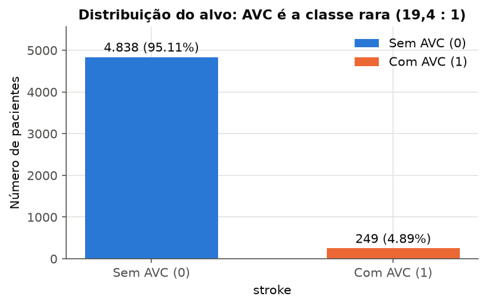
/// caption
**Figura 1**: distribuição de `stroke` no arquivo limpo (5.087 linhas).
///

| Classe | Pacientes | % |
|--------|---------:|--:|
| 0: sem AVC | 4.838 | 95,11% |
| 1: com AVC | 249 | 4,89% |

A razão de desbalanceamento é de **19,43 : 1**. Um classificador que sempre responde "sem
AVC" acerta **95,11%** e não identifica nenhum caso. Por isso a acurácia é inútil aqui: a
próxima entrega vai se medir por **PR-AUC, recall e precisão da classe 1 e acurácia
balanceada**. O baseline de ranking a superar é a AUC de 0,833 que a idade obtém sozinha.

### 1D. Train/test split

Usamos `train_test_split` com `test_size=0.20`, **`stratify=y`** e `random_state=42`
(`split()` em `code/preprocessing.py`), aplicado ao arquivo limpo. O split é feito **antes
de qualquer estatística de pré-processamento**. Daqui em diante, toda análise e todo `fit`
usam apenas o treino.

| Conjunto | Linhas | AVC | % AVC |
|----------|-------:|----:|------:|
| Treino | 4.069 | 199 | 4,89% |
| Teste | 1.018 | 50 | 4,91% |

A estratificação é necessária: com só 249 positivos, um split aleatório simples poderia
deslocar a proporção de forma visível. Cada paciente aparece uma única vez (`id` único),
então não há entidade repetida que possa cair nos dois lados. Com apenas 50 positivos no
teste, cada caso vale 2 pontos de recall. A seleção de modelo será feita por validação
cruzada estratificada no treino, e o teste será usado uma única vez.

---

## 2. Univariate analysis

### 2A. Numerical features

Estatísticas no treino (n = 4.069; para `bmi`, n = 3.907 não ausentes):

| Feature | Média | Mediana | Desvio | Mín | Q1 | Q3 | Máx | Assimetria | Outliers (IQR) |
|---------|------:|--------:|-------:|----:|---:|---:|----:|-----------:|---------------:|
| `age` | 42,92 | 44,00 | 22,58 | 0,08 | 25,00 | 60,00 | 82,00 | −0,13 | 0 (0%) |
| `avg_glucose_level` | 106,09 | 92,00 | 45,00 | 55,12 | 77,46 | 113,80 | 271,74 | 1,57 | 496 (12,19%) |
| `bmi` | 28,86 | 28,00 | 7,91 | 10,30 | 23,50 | 33,00 | 97,60 | 1,14 | 90 (2,30%) |

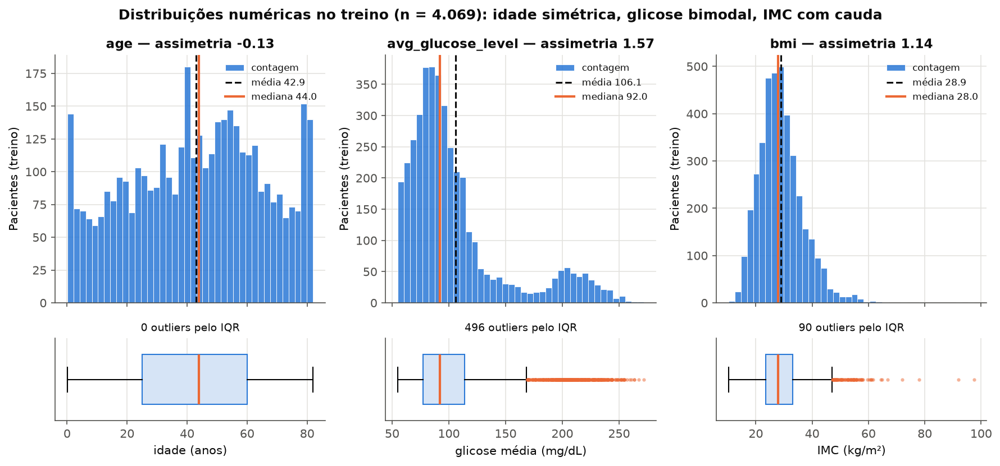
/// caption
**Figura 2**: histogramas (com média e mediana) e boxplots das três numéricas no treino.
///

- **`age`** é praticamente simétrica (assimetria −0,13; média 42,92 ≈ mediana 44) e espalhada
  por toda a faixa, sem outliers pelo IQR. Há picos nas pontas: bebês e um acúmulo em 78–82
  anos, que sugere idade truncada em 82. 16,83% do treino tem menos de 18 anos.
- **`avg_glucose_level`** é **bimodal**: um modo principal em 75–100 mg/dL (glicemia normal)
  e um segundo em 190–230 mg/dL (faixa diabética), separados por um vale. A cauda direita
  puxa a média (106,09) para longe da mediana (92,00). Os 496 "outliers" do IQR (acima de
  168,31) **são o segundo modo**, não erros: 14,30% do treino tem glicose acima de 150.
  Removê-los apagaria um subgrupo clínico.
- **`bmi`** tem assimetria à direita (1,14), com centro em 28 e cauda longa. Os 90 outliers
  do IQR (acima de 47,25) incluem valores implausíveis, até 97,6.

Consequência: `age` só precisa de padronização; `avg_glucose_level` e `bmi` precisam de uma
transformação que reduza a assimetria e de um teto para a cauda (4A).

### 2B. Categorical features

Frequências no treino (após a limpeza):

| Feature | k | Categorias (% do treino) |
|---------|--:|--------------------------|
| `gender` | 2 | Female 58,52 · Male 41,48 |
| `ever_married` | 2 | Yes 65,40 · No 34,60 |
| `work_type` | 4 | Private 57,34 · Self-employed 15,85 · children 13,79 · Govt_job 13,03 |
| `Residence_type` | 2 | Urban 50,31 · Rural 49,69 |
| `smoking_status` | 4 | never smoked 36,50 · Unknown 30,33 · formerly smoked 17,57 · smokes 15,61 |
| `hypertension` | 2 | 0: 90,24 · 1: 9,76 |
| `heart_disease` | 2 | 0: 94,86 · 1: 5,14 |

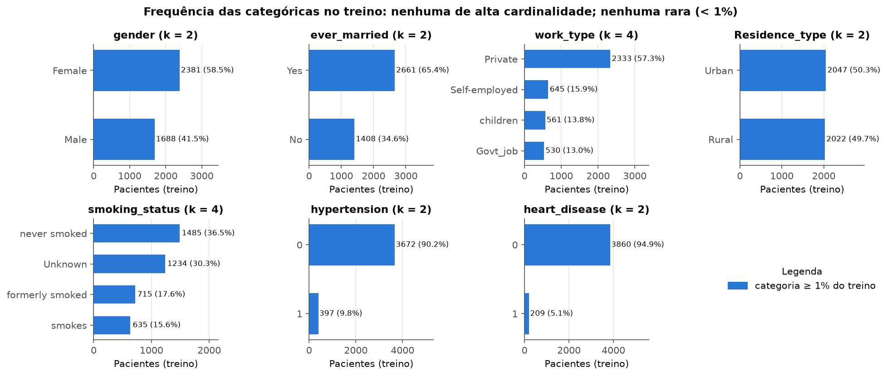
/// caption
**Figura 3**: frequência de cada categoria no treino; nenhuma fica abaixo de 1%.
///

- **Categorias raras.** No arquivo bruto havia duas: `gender = Other`, com 1 linha (0,02%),
  e `work_type = Never_worked`, com 22 (0,43%). Foram removidas na 1B. No treino limpo, a
  menor categoria é `heart_disease = 1`, com 5,14%.
- **Nenhuma feature tem alta cardinalidade.** O máximo é 4, então one-hot é barato:
  14 colunas para as 5 nominais (4C).
- **`Unknown` não é rara (30,33%), mas é ausência disfarçada.** É também a categoria das
  crianças (3C). Fica como categoria própria, porque apagá-la ou imputá-la destruiria esse
  sinal.
- `hypertension` e `heart_disease` são condições minoritárias (9,76% e 5,14%). São justamente
  as que mais elevam o risco (3B).

---

## 3. Bivariate and multivariate analysis

### 3A. Numerical correlations

**Método: Spearman.** `avg_glucose_level` é bimodal e `bmi` tem cauda longa. O coeficiente de
Pearson mede relação *linear* e é sensível a esses extremos; o de Spearman usa postos, então
mede relação *monotônica* e é robusto à cauda. Mostramos Pearson ao lado para comparação, e
incluímos as binárias como 0/1 e o alvo (com alvo binário, Pearson é a correlação
ponto-bisserial).

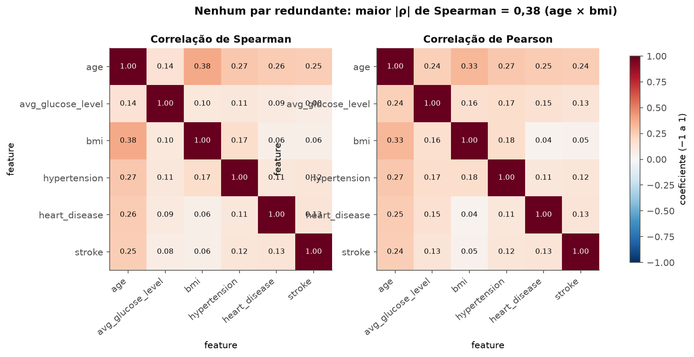
/// caption
**Figura 4**: correlações de Spearman e de Pearson no treino.
///

| Par | Spearman ρ | Pearson r |
|-----|-----------:|----------:|
| `age` × `bmi` | **0,380** | 0,332 |
| `age` × `hypertension` | 0,272 | 0,268 |
| `age` × `heart_disease` | 0,258 | 0,252 |
| `bmi` × `hypertension` | 0,174 | 0,178 |
| `age` × `avg_glucose_level` | 0,143 | 0,236 |

**Não há pares redundantes.** O par mais correlacionado é `age` × `bmi`, com ρ = 0,380, muito
abaixo do limiar usual de redundância (|ρ| > 0,8). Essa correlação vem quase toda das
crianças: entre adultos (≥ 18 anos), ρ cai para 0,086. Mantemos as três numéricas.

**Com o alvo**, `age` domina (ρ = 0,249). Doença cardíaca (0,128) e hipertensão (0,121) vêm em
seguida. A glicose tem Pearson (0,129) maior que Spearman (0,076): o efeito dela está **na
cauda**, no modo diabético, e não ao longo da faixa toda. É o que um coeficiente de postos
subestima, e o motivo de mostrar os dois.

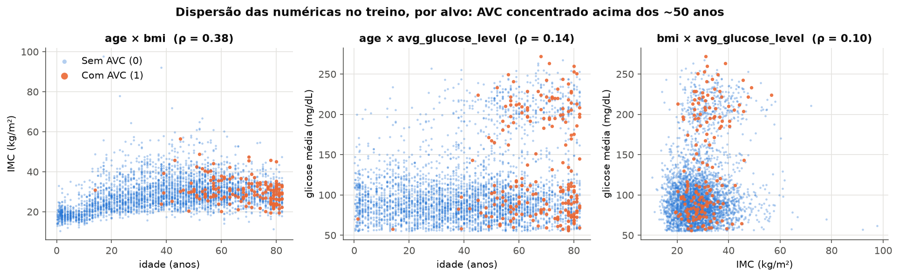
/// caption
**Figura 5**: pares de numéricas no treino, coloridos pelo alvo.
///

A dispersão confirma: os AVCs (laranja) quase não aparecem abaixo dos ~40 anos e se
adensam na faixa de glicose alta. No painel `age` × `bmi`, o "braço" de IMC baixo em
idades baixas são as crianças.

**Redundância do lado categórico** (V de Cramér, no treino): `ever_married` × `work_type` =
0,563, `ever_married` × `smoking_status` = 0,353 e `work_type` × `smoking_status` = 0,305.
Todas compartilham o mesmo fator escondido, a idade. A razão de correlação η de `age` por
`work_type` é de 0,682: `work_type = children` é praticamente uma função da idade (≤ 16
anos). A redundância é moderada, não total, e para uma rede neural não justifica descartar
colunas. Fica registrada como confusão a observar na interpretação.

### 3B. Categorical-target relationships

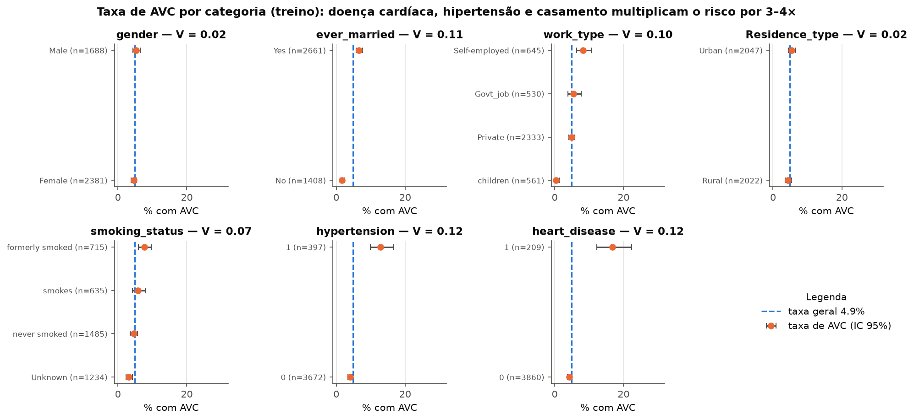
/// caption
**Figura 6**: proporção de AVC por categoria no treino, com IC 95% de Wilson; a linha
tracejada é a taxa geral (4,89%).
///

| Feature | Categoria → taxa de AVC (n) | V de Cramér | χ² p |
|---------|-----------------------------|------------:|-----:|
| `heart_disease` | 1 → **16,75%** (209) · 0 → 4,25% (3.860) | 0,125 | 1,3 × 10⁻¹⁵ |
| `hypertension` | 1 → **12,85%** (397) · 0 → 4,03% (3.672) | 0,119 | 2,7 × 10⁻¹⁴ |
| `ever_married` | Yes → **6,61%** (2.661) · No → 1,63% (1.408) | 0,109 | 4,2 × 10⁻¹² |
| `work_type` | Self-employed **8,22%** · Govt_job 5,47% · Private 4,93% · children 0,36% (2 de 561) | 0,100 | 8,2 × 10⁻⁹ |
| `smoking_status` | formerly smoked **7,69%** · smokes 5,83% · never smoked 4,58% · Unknown 3,16% | 0,073 | 8,2 × 10⁻⁵ |
| `Residence_type` | Urban 5,42% · Rural 4,35% | 0,024 | 0,13 |
| `gender` | Male 5,33% · Female 4,58% | 0,016 | 0,31 |

Conclusões:

- **Doença cardíaca e hipertensão multiplicam a taxa de AVC por 3,9 e 3,2**, e seus ICs não
  se sobrepõem aos do grupo sem a condição. São os sinais categóricos mais fortes.
- **`ever_married`, `work_type` e `smoking_status` são, em boa parte, idade disfarçada.**
  "Casado" (6,61% contra 1,63%), "ex-fumante" (mediana de 57 anos) e "children" (0,36%)
  separam faixas etárias. Não dá para ler "casar quadruplica o risco": o efeito é confundido
  pela idade.
- **`gender` e `Residence_type` não têm associação detectável** (p = 0,31 e p = 0,13; V ≤
  0,024). Mantemos as duas, porque o custo é de 4 colunas, mas não esperamos contribuição.
- Nenhuma associação é forte (V ≤ 0,125). Isoladamente, nenhuma categórica separa as classes.

### 3C. Numerical-categorical relationships

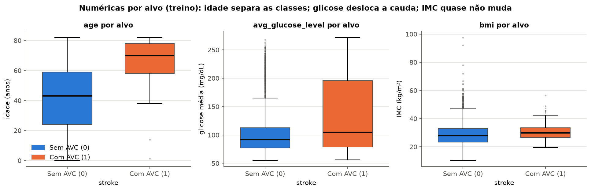
/// caption
**Figura 7**: numéricas agrupadas pelo alvo (treino).
///

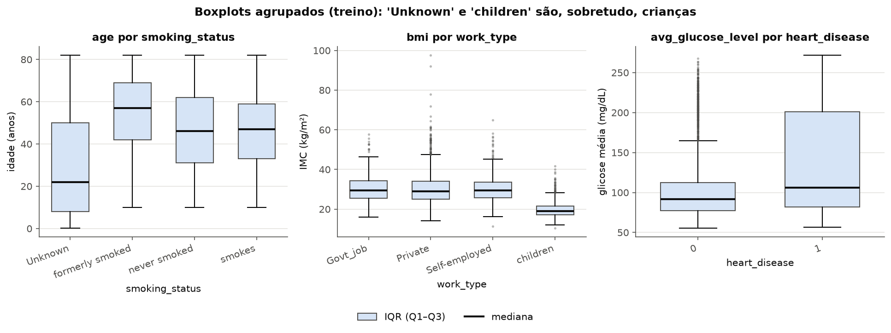
/// caption
**Figura 8**: numéricas agrupadas por categóricas (treino).
///

| Numérica × grupo | Mediana | IQR | Diferem em… |
|------------------|---------|-----|-------------|
| `age` × `stroke` | 0: 43,0 · 1: **70,0** | 0: 35,0 · 1: 20,0 | **posição e dispersão**: os AVCs são mais velhos e concentrados numa faixa estreita |
| `avg_glucose_level` × `stroke` | 0: 91,68 · 1: 104,72 | 0: 35,20 · 1: **116,60** | **sobretudo dispersão**: o IQR triplica porque o grupo com AVC se estende pelo modo diabético |
| `bmi` × `stroke` | 0: 27,90 · 1: 29,80 | 0: 9,60 · 1: 7,00 | pouco: deslocamento de ~2 kg/m² |
| `age` × `smoking_status` | Unknown **22** · formerly 57 · never 46 · smokes 47 | Unknown **42** · 26–31 nos demais | **posição e dispersão**: `Unknown` concentra crianças e é bem mais espalhado |
| `bmi` × `work_type` | children **18,9** · demais ≈ 29 | children 4,40 · demais 8–9 | **posição e dispersão**: crianças têm IMC menor e mais homogêneo |
| `avg_glucose_level` × `heart_disease` | 0: 91,55 · 1: 106,23 | 0: 35,10 · 1: **119,25** | **sobretudo dispersão**, como no alvo |

Duas leituras importam para a modelagem:

1. A glicose separa os grupos pela **cauda**, não pela mediana. Uma transformação que
   comprima a cauda (4A) não pode apagar a distinção entre os dois modos. Yeo-Johnson
   preserva a ordem, então o modo alto continua separado.
2. `Unknown` e `children` são, sobretudo, idade baixa. A rede vai receber essa informação
   de forma redundante, o que é inofensivo, mas é mais um motivo para não interpretar
   coeficientes de `smoking_status` como efeito do fumo.

---

## 4. Preprocessing

### 4A. Strategies

Cada estratégia sai de um achado acima e é **ajustada só no treino**. Elas foram pensadas
para o destino do pipeline, uma rede neural, que é treinada por gradiente. Para isso,
**toda entrada deve chegar com média 0 e desvio 1**: numéricas e categóricas igualmente,
sem NaN e sem colunas quase vazias.

| # | Problema (seção) | Estratégia | Ajustado no treino |
|---|------------------|------------|--------------------|
| 1 | **Categorias raras**: `Other` e `Never_worked` (1B, 2B) | **remover as 23 linhas** antes do split (filtro por valor) | — |
| 2 | **Ausentes**: `bmi`, 3,93%, não aleatório (1B) | imputar com a **mediana** (assimetria 1,14 torna a média enviesada) e adicionar o indicador `missingindicator_bmi` (0/1) | mediana = 28,0 kg/m²; 162 imputações no treino, 39 no teste |
| 3 | **Ausente disfarçado**: `smoking_status = Unknown`, 30,22% (1B, 3C) | manter como **categoria própria**: imputar inventaria fumo em crianças | — |
| 4 | **Outliers**: cauda da glicose = segundo modo; IMC até 97,6 (2A) | **nenhuma linha removida** (só há 199 positivos no treino); **winsorizar** nos quantis 0,5% e 99,5% | glicose ∈ [55,85; 248,23]; IMC ∈ [14,30; 56,40]; **83 linhas** afetadas (2,04%): 42 pela glicose, 41 pelo IMC |
| 5 | **Assimetria** de glicose e IMC (2A) | **Yeo-Johnson** | assimetria: glicose 1,57 → 0,08; IMC 1,14 → 0,00 |
| 6 | **Codificação**: 5 nominais, cardinalidade ≤ 4 (2B) | **one-hot completo** (uma coluna por categoria, inclusive nas binárias de texto) | categorias do treino |
| 7 | **Categoria nova em produção** | `handle_unknown="ignore"`: categoria desconhecida vira o vetor sem nenhum "1" antes da escala, distinto de toda categoria conhecida | teste: `gender = "Other"` → (`gender_Female`, `gender_Male`) = (−1,19; −0,84) |
| 8 | **Escala**: numéricas em unidades diferentes (anos, mg/dL, kg/m²) e colunas 0/1 com médias diferentes (2A, 2B) | **um único `StandardScaler` sobre as 20 colunas de saída**, numéricas e 0/1 | média 0 e desvio 1 em todas as 20 |
| 9 | Desbalanceamento 19,4 : 1 (1C) | **não é pré-processamento**; vai para a modelagem: pesos de classe na perda e limiar ajustado em validação. Nada de SMOTE antes do split | — |

**Por que one-hot.** As 5 nominais não têm ordem: Private, Self-employed, Govt_job e
children não ficam "entre" um e outro.

- Codificar como inteiro (0, 1, 2, 3) obrigaria a rede a desfazer uma ordem falsa.
- Com cardinalidade máxima de 4, *embeddings* não se pagam: eles servem quando há dezenas
  ou centenas de categorias.
- O one-hot é **completo**, sem descartar uma coluna de referência. A multicolinearidade
  que isso cria importa para regressão linear sem regularização, não para uma rede, e
  mantém um código explícito para "categoria desconhecida" (linha 7).

**Por que escalar todas as features, inclusive as 0/1.** Uma rede treinada por gradiente
converge melhor quando toda entrada tem média 0 e variância parecida. Uma entrada sempre
positiva empurra todos os pesos de um neurônio na mesma direção a cada passo. Uma
entrada com variância muito menor que as outras recebe, na prática, uma taxa de
aprendizado menor. Por isso o pipeline termina com **um único `StandardScaler` sobre as
20 colunas**, depois das transformações de cada tipo, e não um scaler só nas numéricas.

**Consequência a acompanhar.** Uma coluna 0/1 com proporção p passa a valer √((1−p)/p)
quando o paciente está na categoria. As categorias raras viram os maiores valores da
entrada:

- `missingindicator_bmi = 1` vale +4,91, `heart_disease = 1` vale +4,30 e
  `hypertension = 1` vale +3,04.
- O maior valor de uma numérica é +2,75, no IMC.

Isso é deliberado: `heart_disease` e `hypertension` são justamente as categóricas mais
associadas ao alvo (3B), e a 4B mostra que dar a elas esse peso **concentra os AVCs nas
vizinhanças**. A alternativa, só centralizar as colunas 0/1, fica registrada como variação
a comparar na entrega 2.

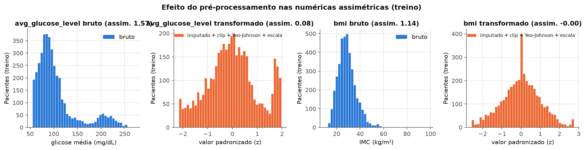
/// caption
**Figura 9**: glicose e IMC antes (azul) e depois (laranja) de imputação + winsorização +
Yeo-Johnson + escala, no treino.
///

Por que o Yeo-Johnson antes da escala: com assimetria de 1,57, a glicose só padronizada
teria uma cauda até ~+3,7 desvios. Uma `tanh` ou uma ReLU recebendo isso coloca poucos
pacientes em regiões de gradiente muito diferentes do resto. Com o Yeo-Johnson, o
máximo fica em +1,97.

### 4B. Dimensionality reduction

As três projeções usam as **20 features escaladas do treino**, ou seja, a saída do pipeline,
todas com média 0 e desvio 1, coloridas pelo alvo.

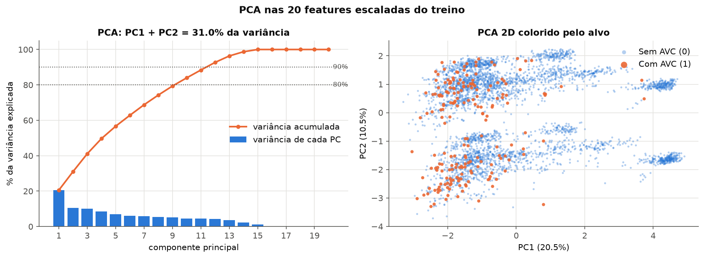
/// caption
**Figura 10**: PCA. Variância explicada (individual e acumulada) e projeção em PC1 × PC2.
///

**Variância.** PC1 explica 20,52% e PC2 10,50%: juntos, **31,02%**. São necessárias 10
componentes para 80%, 12 para 90% e 13 para 95%. As 5 últimas têm variância 0. Isso é
esperado: com o one-hot completo, as colunas de cada uma das 5 nominais somam um valor
constante, e são exatamente 5 dependências lineares. Com todas as colunas em variância 1,
nenhum grupo domina, e a variância se espalha por muitas componentes.

**Loadings.**

| PC1 (20,52%) | loading | PC2 (10,50%) | loading |
|---|---:|---|---:|
| `ever_married_No` | +0,418 | `gender_Female` | **+0,640** |
| `ever_married_Yes` | −0,418 | `gender_Male` | **−0,640** |
| `age` | −0,412 | `smoking_status_never smoked` | +0,223 |
| `work_type_children` | +0,404 | `heart_disease` | −0,166 |
| `smoking_status_Unknown` | +0,313 | `smoking_status_formerly smoked` | −0,135 |
| `bmi` | −0,301 | `work_type_Private` | +0,135 |

- **PC1 é um eixo de "fase da vida"**: à direita, solteiro, criança e tabagismo
  `Unknown`; à esquerda, idade e IMC altos. O sinal é arbitrário. O aglomerado isolado em
  PC1 ≈ +4,5 são as crianças.
- **PC2 é o gênero**: as duas faixas horizontais da Figura 10 são mulheres e homens.
- A média de PC1 é −1,42 nos AVCs contra +0,07 no resto: os casos ficam do lado dos mais
  velhos, mas se sobrepõem em toda essa metade da nuvem.

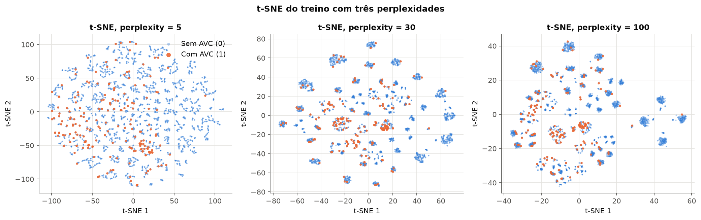
/// caption
**Figura 11**: t-SNE com perplexity = 5, 30 e 100 (`init="pca"`, `random_state=42`).
///

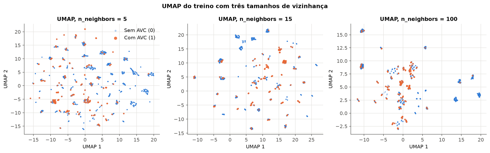
/// caption
**Figura 12**: UMAP com n_neighbors = 5, 15 e 100 (`min_dist=0.1`, `random_state=42`).
///

**Efeito dos parâmetros.**

- Com **perplexity = 5**, o t-SNE só olha vizinhanças minúsculas e devolve uma nuvem
  fragmentada, sem estrutura global. Com **30** surgem dezenas de ilhas compactas. Com
  **100** as ilhas se aproximam e algumas se fundem.
- O UMAP faz o mesmo percurso: **n_neighbors = 5** gera muitos fragmentos espalhados,
  **15** gera ilhas bem separadas, várias quase só laranja, e **100** junta as ilhas com
  AVC no centro e empurra para a periferia os grupos sem AVC.

**O que as ilhas são.** Agrupamos o UMAP com n_neighbors = 15 por DBSCAN (61 clusters) e
medimos a pureza de cada categórica dentro deles:

- **`heart_disease` 99,3%, `hypertension` 96,3%, `work_type` 95,9%, `ever_married`
  93,0%** e `smoking_status` 91,0%.
- `Residence_type` 88,4% e `gender` 87,7%.
- `stroke` dá 95,1%, que é só a proporção da classe majoritária.

Com tudo padronizado, cada binária rara afasta muito os pacientes: entre `heart_disease`
0 e 1 a distância é de ~4,5 desvios. Por isso as ilhas se dividem primeiro pelas
condições clínicas raras, e são essas que mais se associam ao AVC (3B). A geometria que
t-SNE e UMAP enxergam depende de como as categóricas são escaladas.

**Comparação quantitativa.** Para cada ponto com AVC, medimos a fração de AVCs entre seus
10 vizinhos mais próximos. Ao acaso, a fração seria igual à taxa base, 4,89%.

| Espaço | PCA 2D | 20D original | t-SNE 5 / 30 / 100 | UMAP 5 / 15 / 100 |
|--------|-------:|-------------:|-------------------:|------------------:|
| AVC entre os 10 vizinhos de um AVC | 11,26% | 13,07% | 11,46% / 11,51% / 12,61% | 11,66% / 12,06% / 11,11% |

Com a escala completa, o espaço 20D chega a 13,07% (2,7 vezes a taxa base). Com as 0/1 só
centralizadas, a mesma medida dava 9,30%, porque as condições clínicas raras pesavam
pouco na distância.

**O que as projeções não lineares revelam e a PCA não.** A PCA mostra **gradientes
contínuos** (fase da vida em PC1, gênero em PC2), com os AVCs espalhados pela metade dos
mais velhos. t-SNE e UMAP mostram que o espaço é **segmentado em dezenas de subgrupos**
definidos pelas condições clínicas e pela ocupação, e que **alguns subgrupos concentram
AVCs** (as ilhas quase só laranja do UMAP com n_neighbors = 15). Mas **nenhum método
separa as classes**: no melhor caso, cerca de 1 em cada 8 vizinhos de um AVC é AVC. A
fronteira de decisão vai ser difícil, e precisão alta na classe 1 é improvável.

### 4C. Pipeline

O pipeline está em `code/preprocessing.py`, importável pelas entregas seguintes:

```python
from preprocessing import load_raw, clean, split, build_preprocessor

X_train, X_test, y_train, y_test = split(clean(load_raw()))  # estratificado, random_state=42
pre = build_preprocessor().fit(X_train)                      # fit SÓ no treino
Xt_train, Xt_test = pre.transform(X_train), pre.transform(X_test)
```

Saída de `python3 docs/projects/eda/code/preprocessing.py`:

```text
train: (4069, 10) -> (4069, 20)
test:  (1018, 10) -> (1018, 20)
NaN restantes: treino=0, teste=0
20 features: age, avg_glucose_level, bmi, missingindicator_bmi, hypertension, heart_disease,
gender_Female, gender_Male, ever_married_No, ever_married_Yes, work_type_Govt_job,
work_type_Private, work_type_Self-employed, work_type_children, Residence_type_Rural,
Residence_type_Urban, smoking_status_Unknown, smoking_status_formerly smoked,
smoking_status_never smoked, smoking_status_smokes
```

- **Shape final:** treino (4.069, 20), teste (1.018, 20).
- **NaN restantes:** 0 no treino e 0 no teste.
- **Composição das 20 colunas:** 3 numéricas + 1 indicador de ausência + 2 binárias + 14
  one-hot (gender 2, ever_married 2, work_type 4, Residence_type 2, smoking_status 4).
- **Escala:** todas as 20 colunas saem do `StandardScaler` final com média 0 e desvio 1
  no treino.
- **Estrutura:** `Pipeline([("columns", ColumnTransformer(...)), ("scale", StandardScaler())])`.

??? example "code/preprocessing.py — pipeline (Pipeline + ColumnTransformer)"

    ```python
    --8<-- "docs/projects/eda/code/preprocessing.py"
    ```

??? example "code/eda.py — todas as figuras e números deste relatório"

    ```python
    --8<-- "docs/projects/eda/code/eda.py"
    ```

---

## 5. Synthesis

### Principais achados

| # | Achado | Evidência |
|---|--------|-----------|
| 1 | O alvo é muito desbalanceado: 4,89% de AVC (19,43 : 1); acurácia trivial de 95,11% | 1C, Figura 1 |
| 2 | A idade é a feature dominante: AUC isolada de 0,833; mediana de 70 anos nos AVCs contra 43 | 1B, 3C, Figura 7 |
| 3 | A glicose é bimodal; seu efeito está no modo diabético (IQR de 117 nos AVCs contra 35) | 2A, 3C, Figuras 2 e 7 |
| 4 | A falta de IMC prevê o alvo: 17,09% de ausência nos AVCs contra 3,31% (p = 1,9 × 10⁻²¹) | 1B |
| 5 | Hipertensão e doença cardíaca multiplicam a taxa de AVC por 3,2 e 3,9; gênero e residência não importam | 3B, Figura 6 |
| 6 | Várias categóricas são idade disfarçada (V = 0,563 entre `ever_married` e `work_type`; η = 0,682) | 3A, 3C, Figura 8 |
| 7 | Não há redundância numérica: maior ρ = 0,380 (age × bmi), que cai para 0,086 entre adultos | 3A, Figura 4 |
| 8 | Duas categorias raras (23 linhas, 0 AVC) foram removidas sem custo para a classe positiva | 1B, 2B |
| 9 | Nenhuma projeção separa as classes: AVC entre os 10 vizinhos de um AVC fica em 11–13% (base 4,89%), embora alguns subgrupos clínicos concentrem casos | 4B, Figuras 10–12 |

### Riscos para a modelagem e plano

| Risco | Plano |
|-------|-------|
| **Desbalanceamento**: o modelo aprende a responder sempre 0 | pesos de classe na perda; limiar escolhido em validação; métricas: PR-AUC, recall/precisão da classe 1, acurácia balanceada; nunca acurácia |
| **Só 50 positivos no teste**: métricas com variância alta | seleção por validação cruzada estratificada (5 folds) no treino; teste usado uma vez; reportar IC por *bootstrap* |
| **Indicador de IMC ausente pode ser vazamento** | treinar com e sem `missingindicator_bmi` (`build_preprocessor(bmi_indicator=False)`) e reportar a diferença |
| **O modelo pode ser "só idade"** | comparar com o baseline da idade isolada (AUC 0,833); o modelo precisa superá-lo |
| **16,83% de crianças, com só 2 AVCs no treino**, inflam métricas fáceis | reportar métricas também no subconjunto de adultos (≥ 18 anos) |
| **Pacientes `Other` / `Never_worked` em produção** ficam fora da população de treino | o encoder os aceita (vetor desconhecido), mas a previsão para eles não é validada; registrar como limitação |
| **Ordem das linhas = alvo** | split sempre embaralhado; nunca usar o índice |
| **Proveniência desconhecida e dado transversal** | tratar o modelo como exercício preditivo, sem conclusões causais nem clínicas |
| **Valores extremos de IMC** (até 97,6) | winsorização ajustada no treino (4A); revisitar se o modelo mostrar sensibilidade ao IMC |
| **Binárias raras viram entradas grandes** após a escala (`heart_disease = 1` → +4,30) | comparar, na entrega 2, a escala completa com a versão em que as 0/1 são só centralizadas |

O código roda de um clone limpo: o CSV está versionado em `data/`, e
`python3 docs/projects/eda/code/eda.py` regenera as 12 figuras e `code/results.json`.

## Results summary

| # | Results summary | Value |
|---|---|---|
| 1 | Dataset, task and target | Stroke Prediction Dataset (Kaggle) · classificação binária · `stroke` |
| 2 | Instances × features (numerical / categorical) | 5.087 × 10 após a limpeza (5.110 no bruto) · 3 numéricas / 7 categóricas (2 delas 0/1) |
| 3 | Column with the most missing values and its percentage | `bmi`: 201 (3,93%); mais `smoking_status = Unknown` em 30,22% como ausência disfarçada |
| 4 | Dropped columns and the reason | `id`: identificador, sem significado para o paciente (AUC 0,509). Também 23 linhas de categorias raras (`gender = Other`, `work_type = Never_worked`), 0 delas com AVC |
| 5 | Minority class (%) | `stroke = 1`: 4,89% (249 de 5.087) |
| 6 | Size of the training and test sets | treino 4.069 (199 AVC) · teste 1.018 (50 AVC) |
| 7 | Most correlated numerical pair and its value | `age` × `bmi`: Spearman ρ = 0,380 (Pearson 0,332) |
| 8 | Rows affected by the outlier strategy | 83 linhas do treino (2,04%) winsorizadas; 0 removidas |
| 9 | Variance explained by PC1 + PC2 | 31,02% (20,52% + 10,50%) |
| 10 | `shape` of train and test after the pipeline | (4.069, 20) e (1.018, 20); 0 NaN |

## Referências

- fedesoriano. *Stroke Prediction Dataset*. Kaggle, 2021.
  <https://www.kaggle.com/datasets/fedesoriano/stroke-prediction-dataset>
- Laboratório "From EDA to dimensionality reduction" (Palmer Penguins), material da
  disciplina.
- LeCun, Y.; Bottou, L.; Orr, G.; Müller, K.-R. *Efficient BackProp*. In: Neural Networks:
  Tricks of the Trade, Springer, 1998. (Entradas com média zero e variância comparável.)
- scikit-learn: `ColumnTransformer`, `OneHotEncoder`, `PowerTransformer`, `StandardScaler`.
  <https://scikit-learn.org/stable/modules/preprocessing.html>
- McInnes, L.; Healy, J.; Melville, J. *UMAP: Uniform Manifold Approximation and
  Projection*. arXiv:1802.03426, 2018.
- van der Maaten, L.; Hinton, G. *Visualizing Data using t-SNE*. JMLR 9, 2008.
